# Semana 10 — Del simulador al robot real

## Objetivo

Todo lo que armaste hasta ahora corrió contra el simulador. Un robot real
no se comporta igual: la cámara ve otra luz, la imagen se mueve cuando el robot gira y la
odometría se equivoca más. Este último workshop usa **un bag grabado con el
robot real** en una arena con cajas, y el objetivo es **ubicar en el mapa
el centro de cada caja roja**.

No hace falta el robot ni el simulador: el bag reemplaza a los dos. El mapa
lo vas a recibir publicado en `/map`, y es un mapa de la arena **vacía**: las
cajas no están ahí.

Casi no vas a escribir código nuevo. Vas a reusar lo que ya tenés de las
semanas [04](../semana-04-deteccion-color/),
[06](../semana-06-localizacion/) y
[07](../semana-07-obstaculos-no-mapeados/), y el trabajo es descubrir
**qué deja de funcionar** al pasar de lo simulado a lo real, y por qué.

El workshop tiene cinco pasos:

1. Levantar el bag y recibir el mapa.
2. Detectar lo rojo con la cámara real, y los puntos del lidar que caen
   sobre eso.
3. Arreglar la odometría.
4. Localizar al robot en el mapa.
5. Llevar las cajas rojas al mapa y reportarlas en `/victimas`.

Necesitás las semanas [04](../semana-04-deteccion-color/),
[05](../semana-05-launch-rviz/), [06](../semana-06-localizacion/) y
[07](../semana-07-obstaculos-no-mapeados/) completas.

---

## Teoría: qué cambia del simulador al robot real

En el simulador, cada sensor mide exactamente lo que el modelo dice que
tiene que medir, más un ruido prolijo. En el robot real aparecen cosas que
el modelo no tiene:

- **La cámara** ve con la luz del lugar, con reflejos y sombras, y cuando
  el robot gira rápido la imagen sale movida. Los rangos de HSV que
  calibraste en el simulador pueden andar o no.
- **La odometría** sale de contar vueltas de las ruedas. Las ruedas mecanum
  patinan, sobre todo al girar rápido en el lugar, y la cuenta se aleja de
  lo que el robot hizo de verdad. En el simulador ese error es chico; acá no.
- **La pose de partida** es "cerca del origen": al robot lo ubica una
  persona a mano, así que no arranca exactamente en `(0, 0, 0)`.

Lo que **no** cambia es la geometría: el simulador está armado con las
medidas del robot real. La cámara tiene la misma resolución (320 × 240) y
los mismos intrínsecos, y el lidar está montado igual (girado 180°, en los
dos). Si algo de tu código anda en el simulador y no acá, no busques por ese
lado.

Nada de esto se arregla con un parámetro mágico: primero hay que verlo, y
el bag te deja verlo las veces que quieras, siempre con los mismos datos.

---

## Teoría: qué es un bag

Un **bag** es una grabación de topics. `ros2 bag record` se suscribe a los
topics que le pedís y guarda cada mensaje que llega, con la hora en que
llegó, en una carpeta. `ros2 bag play` hace lo inverso: lee esa carpeta y
vuelve a publicar los mismos mensajes, en los mismos topics y con el mismo
ritmo con que se grabaron.


Para tus nodos no hay diferencia: se suscriben a `/scan` o a `/odom` y
reciben mensajes, sin saber si vienen del robot o del bag. Por eso un bag
sirve para probar tu código contra datos reales sin tener el robot, y
para repetir **exactamente** la misma corrida todas las veces que haga
falta, cosa que con el robot no se puede.

La carpeta del bag tiene dos archivos:

- `metadata.yaml`: qué topics hay, de qué tipo, cuántos mensajes y con qué
  QoS se publicaron. Por eso, al reproducir, el lidar y la cámara salen otra
  vez en *Best Effort*.
- `laberinto_victimas_0.db3`: los mensajes en sí (una base de datos SQLite).

Antes de reproducir un bag, mirá qué tiene adentro:

```console
$ ros2 bag info laberinto_victimas
Duration:          120.940116342s
Messages:          16045
Topic information: Topic: /cmd_vel | Type: geometry_msgs/msg/Twist | Count: 963
                   Topic: /cam_1/color/image_raw | Type: sensor_msgs/msg/Image | Count: 3596
                   Topic: /cam_1/color/camera_info | Type: sensor_msgs/msg/CameraInfo | Count: 3609
                   Topic: /joint_states | Type: sensor_msgs/msg/JointState | Count: 1205
                   Topic: /imu/data | Type: sensor_msgs/msg/Imu | Count: 1210
                   Topic: /odom | Type: nav_msgs/msg/Odometry | Count: 1210
                   Topic: /scan | Type: sensor_msgs/msg/LaserScan | Count: 915
                   Topic: /tf_static | Type: tf2_msgs/msg/TFMessage | Count: 2
                   Topic: /robot_description | Type: std_msgs/msg/String | Count: 1
                   Topic: /scan_filtered | Type: sensor_msgs/msg/LaserScan | Count: 915
                   Topic: /tf | Type: tf2_msgs/msg/TFMessage | Count: 2419
```

(La salida real trae algunas líneas y columnas más; acá quedaron las
importantes.)
Con la cantidad de mensajes y la duración sacás la frecuencia de cada
topic: 915 scans en 121 s son unos 7,6 Hz.

**El reloj.** Cada mensaje trae en su `header.stamp` la hora de la
grabación, no la de ahora. Si tus nodos usan el reloj de tu computadora,
esas horas no coinciden con nada y tf2 no puede cruzar los datos del bag
con lo que publican tus nodos. Para eso están dos piezas que van juntas:

- `ros2 bag play --clock` publica en `/clock` la hora de la grabación,
  avanzando al ritmo del bag.
- `use_sim_time:=true` en cada nodo hace que use `/clock` en vez del reloj
  de la computadora.

Es el mismo mecanismo que usa Gazebo: el simulador también publica
`/clock`, y por eso venías usando `use_sim_time`.

Para leer más:

- [Recording and playing back data](https://docs.ros.org/en/humble/Tutorials/Beginner-CLI-Tools/Recording-And-Playing-Back-Data/Recording-And-Playing-Back-Data.html),
  el tutorial oficial de ROS 2 Humble (record, play, info, con turtlesim).
- [Clock and Time](https://design.ros2.org/articles/clock_and_time.html),
  el diseño del reloj de ROS 2: qué es `use_sim_time` y cómo funciona `/clock`.

---

## Material

| Archivo | Qué es |
|---|---|
| `laberinto_victimas/` | Bag de 2 minutos grabado en el robot real, en la arena con cajas. Se baja de la [release `semana-10-datos`](https://github.com/AIRclub-UdeSA/jar_workshops/releases/tag/semana-10-datos) (≈ 500 MB comprimido, ≈ 800 MB descomprimido). |
| [`mapa_laberinto/mapas/laberinto_vacio.yaml`](mapa_laberinto/mapas/laberinto_vacio.yaml) | Mapa de la misma arena **sin cajas** (≈ 1,9 × 1,25 m, 5 cm por celda). Ya viene en el paquete. |

Topics del bag:

| Topic | Qué trae |
|---|---|
| `/scan` | Lidar, 7,6 Hz, **Best Effort** |
| `/odom` | Odometría de las ruedas, 10 Hz |
| `/imu/data` | IMU, 10 Hz |
| `/tf`, `/tf_static` | Árbol de transformadas del robot (`odom → base_footprint → ...`) |
| `/cam_1/color/image_raw` | Cámara a color, 30 Hz, 320 × 240, **Best Effort** |
| `/cam_1/color/camera_info` | Intrínsecos de la cámara |
| `/cmd_vel`, `/joint_states` | Lo que se le mandó al robot y el estado de las ruedas |
| `/scan_filtered` | Copia de `/scan` filtrada por el robot, pero casi sin rayos válidos (unos 9 de 1080). **No la uses**: usá `/scan`. |

El bag **no tiene `/map` ni la transformada `map → odom`**: el mapa lo
publica el paquete de esta semana, y `map → odom` lo vas a publicar vos cuando localices al robot (paso 4).

Tampoco tiene profundidad: para saber a qué distancia está algo que ve la
cámara, vas a usar el lidar, igual que en la semana 04.

---

## Antes de empezar: el paquete `mapa_laberinto`

Este paquete ya viene armado. Tiene un solo nodo, `publicar_mapa`, que
publica el mapa **una vez** en `/map`, con QoS *reliable* + *transient local* y
`frame_id: map`. Como queda retenido, tus nodos lo reciben aunque arranquen
después. No publica ninguna transformada: ubicarse en el mapa es trabajo
tuyo.

```bash
source ~/rosmaster_ws/install/setup.bash
cd ~/rosmaster_ws
colcon build --packages-select mapa_laberinto
```

Bajá el bag y descomprimilo en `~/rosmaster_ws/bags/` (si lo dejás en otro
lado, cambiá la ruta en los comandos de abajo):

```bash
source ~/rosmaster_ws/install/setup.bash
mkdir -p ~/rosmaster_ws/bags && cd ~/rosmaster_ws/bags
curl -L -O https://github.com/AIRclub-UdeSA/jar_workshops/releases/download/semana-10-datos/laberinto_victimas.tar.gz
tar xzf laberinto_victimas.tar.gz
ros2 bag info laberinto_victimas
```

Queda una carpeta `laberinto_victimas/` con dos archivos: `metadata.yaml` y
`laberinto_victimas_0.db3`.

---

## Paso 1 — Levantar el bag y recibir el mapa

### Qué hacer

Abrí cuatro terminales.
**El orden importa** (ver el aviso de abajo): primero el bag, en pausa.

```bash
# Terminal 1 — el bag, en pausa (-p): ya publica su reloj en /clock
source ~/rosmaster_ws/install/setup.bash
ros2 bag play ~/rosmaster_ws/bags/laberinto_victimas --clock -p
```

```bash
# Terminal 2 — el mapa
source ~/rosmaster_ws/install/setup.bash
ros2 launch mapa_laberinto mapa.launch.py
```

```bash
# Terminal 3 — map → odom fijo en cero (provisorio, ver abajo)
source ~/rosmaster_ws/install/setup.bash
ros2 run tf2_ros static_transform_publisher --frame-id map --child-frame-id odom --ros-args -p use_sim_time:=true
```

```bash
# Terminal 4 — tu RViz
source ~/rosmaster_ws/install/setup.bash
rviz2 --ros-args -p use_sim_time:=true
```

Con todo abierto, volvé a la Terminal 1 y apretá la **barra espaciadora**
para que el bag arranque. La misma tecla lo pausa y lo despausa.

`--clock` hace que el bag publique su propio reloj en `/clock`, y
`use_sim_time:=true` hace que cada nodo use ese reloj en vez del de tu
computadora (ver "Teoría: qué es un bag").

> [!WARNING]
> **Si el mapa desaparece de RViz cuando arranca el bag, es el reloj.** Un
> nodo con `use_sim_time:=true` que arrancó antes que `/clock` ve la hora
> saltar de 0 a la hora de la grabación, y RViz se reinicia solo
> (`Detected jump back in time. Resetting RViz.` en la terminal). El mapa se
> publica una sola vez, así que puede no volver a aparecer. Por eso el bag
> va primero y en pausa: cuando RViz arranca, `/clock` ya tiene la hora de la
> grabación y no hay salto. Si te pasa igual (por ejemplo, al volver a
> correr el bag desde el principio), cerrá RViz y la Terminal 2 y volvé a
> abrirlas.

La Terminal 3 es una trampa a propósito: dice "el robot arrancó
exactamente en el origen del mapa y la odometría nunca se equivoca". Sin
eso no hay forma de dibujar el lidar sobre el mapa, porque nadie publica
`map → odom`. **Cuando localices al robot (paso 4) la vas a cerrar**,
porque tu localizador publica esa misma transformada y las dos se pisarían.

Armá el RViz como en la [semana 05](../semana-05-launch-rviz/):

- `Fixed Frame` en `map`.
- `Map` en `/map`, con `Durability Policy` en **Transient Local** (mismo
  ajuste que en la [semana 06](../semana-06-localizacion/)).
- `LaserScan` en `/scan`.
- `Image` en `/cam_1/color/image_raw`.
- Dos displays `Axes`: uno con `Reference Frame` en `odom` y otro en
  `base_footprint`, para ver dónde cree el robot que está. (El display `TF`
  también sirve, pero muestra cada rueda y cada sensor y tapa al robot.)

Guardá la configuración (`File → Save Config As`): la vas a usar en todos
los pasos que siguen.

> [!WARNING]
> **Si la imagen o el lidar no aparecen, es la QoS.** El robot publica la
> cámara y el lidar en **Best Effort**, y un display de RViz puede quedar
> suscripto en *Reliable*. Un suscriptor *reliable* no se conecta con un
> publicador *best effort*, y no avisa. Abrí la sección `Topic` de cada
> display y poné `Reliability Policy` en **Best Effort**. En tu código pasa
> lo mismo: por eso te suscribís con `qos_profile_sensor_data`.

### Qué vas a ver

Al principio, con el robot quieto en el punto de partida, el lidar calza **casi**
con las paredes del mapa y la cámara muestra una caja roja al fondo:

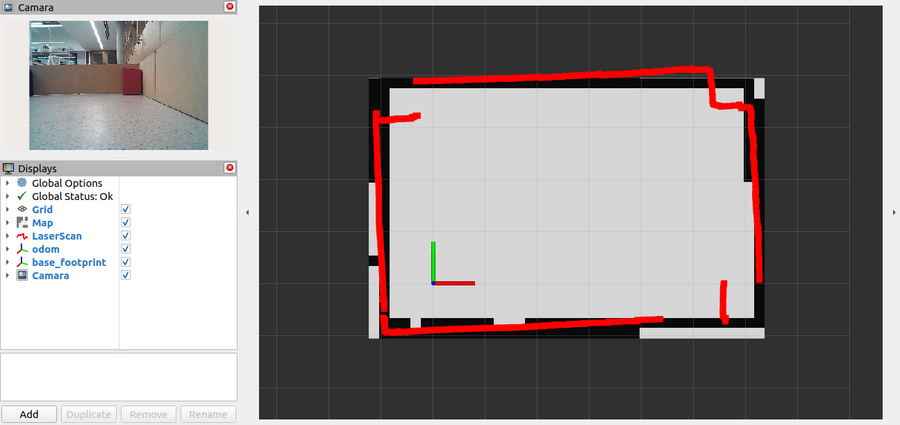

Después de los primeros giros, el lidar ya no tiene nada que ver con el
mapa, y el robot aparece sobre la pared o afuera de la arena:

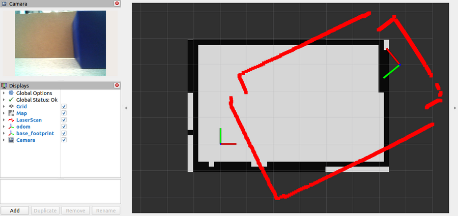

Los primeros 55 segundos del bag, a velocidad ×2:

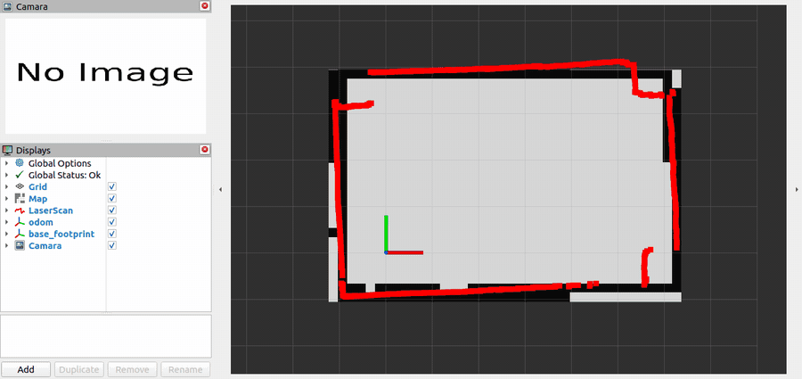

### Comprobación

- En la Terminal 2 aparece `Mapa publicado en /map: 38x25 celdas`.
- RViz muestra el mapa, el lidar y la imagen de la cámara.
- Con `ros2 topic info /cam_1/color/image_raw --verbose` podés ver la QoS
  con la que publica el bag.

Antes de seguir, contestate estas preguntas mirando el bag (podés pausarlo
con la barra espaciadora en la Terminal 1):

- Con el robot todavía quieto, ¿el lidar calza exacto con las paredes? Si
  no, ¿está corrido, girado o las dos cosas? ¿Qué te dice eso sobre la
  pose de partida?
- En el lidar aparecen esquinas "recortadas" que el mapa no tiene. ¿Qué son?
- ¿En qué momento del bag el lidar deja de calzar con el mapa? ¿Pasa cuando
  el robot avanza o cuando gira?
- Si la Terminal 3 dice "la odometría nunca se equivoca", ¿qué te está
  mostrando RViz?

---

## Paso 2 — Detectar el rojo con la cámara real

En la [semana 04](../semana-04-deteccion-color/) armaste dos nodos contra
el simulador: `detector` (parte 1), que decide si la cámara ve un cuadrado
rojo y publica `/rojo_detectado`, y `detector_scan` (parte 2), que proyecta
cada punto del lidar sobre la imagen y publica en `/scan_rojo` solo los que
caen sobre rojo. Ahora los vas a correr **sin cambiar nada** contra el robot
real y vas a comprobar qué se transfiere y qué no.

Además vas a hacer dos cosas nuevas: ver en RViz la máscara que calcula tu
detector, y armar **tu launch**, el que va a ir creciendo en cada
paso.

### Qué hacer

**1. Publicar la máscara.** Tu `detector` calcula una máscara (blanco donde
ve rojo, negro en el resto) y la usa solo por dentro. Publicala como imagen
para poder verla en RViz. En `detector.py`:

- En `__init__`, creá un publisher de `sensor_msgs/Image` en `mascara_rojo`
  y una variable `self.ultimo_header = None`.
- En `recibir_imagen`, guardá `msg.header` en `self.ultimo_header`.
- En `hay_cuadrado_rojo`, después de calcular la máscara, convertila con
  `self.puente.cv2_to_imgmsg(mascara, encoding='mono8')`, poné
  `self.ultimo_header` como `header` del mensaje y publicalo.

`mono8` es una imagen de un solo canal, de 0 a 255: justo lo que es una
máscara. Volvé a compilar `deteccion_color`.

**2. Tu launch.** En tu propio paquete (el que armaste desde la
[semana 05](../semana-05-launch-rviz/)), creá un launch que levante:

- la transformada fija `map → odom` en cero del paso 1, ahora como nodo del
  launch (`package='tf2_ros'`, `executable='static_transform_publisher'`,
  `arguments=['--frame-id', 'map', '--child-frame-id', 'odom']`);
- `detector` y `detector_scan` del paquete `deteccion_color`;
- `rviz2` con la configuración que guardaste en el paso 1 (`arguments=['-d', <ruta>]`).

Todos con `parameters=[{'use_sim_time': True}]`. Si te falta uno, ese nodo
usa el reloj de tu computadora y no cruza bien con los datos del bag.

El bag y el mapa **no** van en tu launch: el bag hace de robot y el mapa
viene de afuera. Así, tu launch tiene solo lo tuyo, lo mismo que correrías
con el robot real.

**3. Sumá a tu RViz** un `LaserScan` en `/scan_rojo` (de otro color y con
puntos más grandes que el `/scan`) y un segundo `Image` en `/mascara_rojo`.
Guardá la configuración.

Ahora alcanza con tres terminales:

```bash
# Terminal 1 — el bag, en pausa
source ~/rosmaster_ws/install/setup.bash
ros2 bag play ~/rosmaster_ws/bags/laberinto_victimas --clock -p
```

```bash
# Terminal 2 — el mapa
source ~/rosmaster_ws/install/setup.bash
ros2 launch mapa_laberinto mapa.launch.py
```

```bash
# Terminal 3 — tu launch (cambiá paquete y nombre por los tuyos)
source ~/rosmaster_ws/install/setup.bash
ros2 launch <tu_paquete> <tu_launch>.launch.py
```

Cuando abra RViz, apretá la barra espaciadora en la Terminal 1.

> [!NOTE]
> **Para mirar un tramo del bag, no uses `--start-offset`.** `/tf_static`
> (las transformadas fijas del robot: dónde están el lidar y la cámara) se
> publica una sola vez, al principio del bag. Si arrancás más adelante te lo
> salteás y RViz no puede dibujar el lidar. Reproducí desde el principio y
> cambiá la velocidad: `-r 2` al lanzarlo, o las flechas ↑ ↓ en la Terminal 1
> mientras corre.

### Qué vas a ver

Arriba a la izquierda, la máscara: una mancha blanca con la forma de la
caja y todo lo demás negro. Abajo, la cámara. En el mapa, los puntos de
`/scan_rojo` (en verde) caen sobre la caja, en la esquina de abajo a la
derecha:

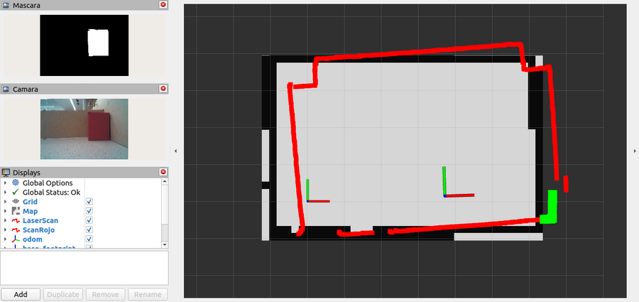

### Comprobación

- `ros2 topic echo /rojo_detectado` muestra `data: true` mientras se ve una
  caja. Cuando no ve ninguna, el topic queda callado: tu detector solo
  publica `True`.
- `ros2 topic hz /mascara_rojo` publica a la frecuencia del timer de tu
  detector.
- En RViz, los puntos verdes aparecen sobre las cajas.

Preguntas para contestarte mirando el bag:

- ¿Tuviste que cambiar los rangos de HSV o el área mínima para que el
  detector ande con la cámara real? ¿Por qué creés que sí o que no?
- `detector_scan` nunca supo cómo está montado el lidar en el robot. ¿Cómo
  sabe dónde cae cada rayo en la imagen?
- Recorré el bag entero. ¿Aparecen puntos verdes que **no** están sobre una
  caja? ¿Qué está haciendo el robot en esos momentos?

### Desafío extra: no confiar en el rojo mientras el robot gira

Si miraste bien la última pregunta, viste esto: cuando el robot gira rápido,
los puntos verdes se "corren" por la pared al lado de la caja (bag a
velocidad ×0,5):

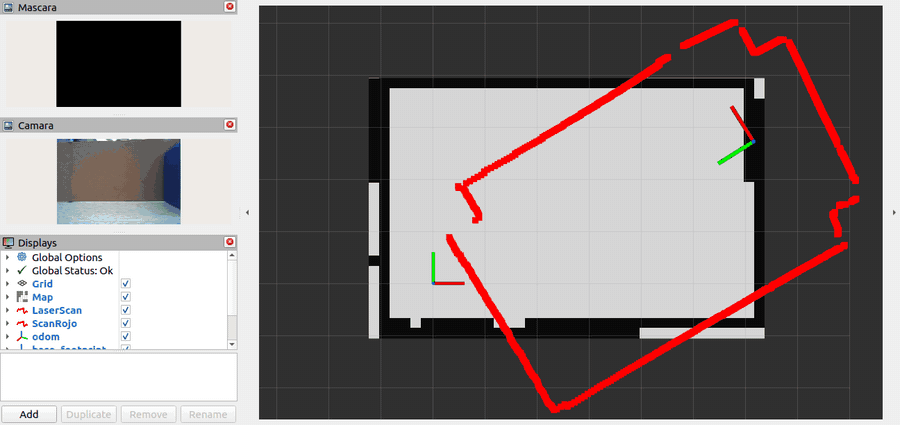

La causa está en cómo `detector_scan` junta los dos sensores: en cada scan
usa **la última imagen que llegó**, sin mirar de qué momento es. Y un scan
no es un instante: el lidar tarda unos 0,13 s en dar una vuelta (es el
`scan_time` del mensaje). El `header.stamp` del scan marca cuándo
**empezó** esa vuelta, pero el mensaje sale recién cuando termina. La imagen,
en cambio, llega casi apenas se toma. Por eso, en este bag, la última imagen
tiene un `header.stamp` unos 0,11 s **posterior** al del scan: es de cerca
del final de la vuelta. Con el robot quieto no importa. Girando a 50°/s, en
0,13 s el robot gira unos 6,5°: los rayos del principio de la vuelta miraron
para un lado y la imagen es de cuando el robot ya miraba para otro. A 2 m de
distancia, unos 5° corren el punto unos 20 cm.

El desafío: que `detector_scan` no marque ningún punto como rojo mientras el
robot gira más rápido que un umbral.

- Suscribite a `/odom` y guardá la velocidad de giro
  (`msg.twist.twist.angular.z`), igual que guardás la última imagen.
- Agregá un parámetro `giro_maximo` (en rad/s; con 0, el filtro apagado).
- En `recibir_scan`, si `abs(giro) > giro_maximo`, publicá el scan sin
  ningún punto rojo.

Empezá con `giro_maximo` en 0,3 rad/s y probá otros valores. Mirá dos cosas:
cuántos puntos verdes siguen cayendo sobre la pared, y cuántos puntos buenos
perdés. Si el umbral es muy bajo, también tirás puntos de cuando el robot
gira despacio mirando la caja.

Pregunta para pensar: la solución "de libro" sería juntar cada scan con la
imagen de su mismo instante, comparando los `header.stamp`. En este bag,
¿alcanzaría? (Pista: para cada sensor, compará la hora a la que llega el
mensaje con su `header.stamp`, y fijate cuánto dura una vuelta del lidar.
¿A qué instante corresponde el `header.stamp` de un scan?)

---

## Paso 3 — Arreglar la odometría

En el paso 1 viste que, con `map → odom` fijo en cero, el lidar se despega
del mapa apenas el robot gira. Esa transformada fija dice "la odometría
nunca se equivoca", así que lo que viste es **el error de la odometría**.
Ahora lo vas a medir: cuánto se equivoca, en qué, y si se puede corregir.

Así se ve el camino del robot según `/odom` sobre el mapa, desde que
arranca (bag a velocidad ×4). Ya con los primeros giros se tuerce, y
termina cruzando paredes y saliéndose de la arena:

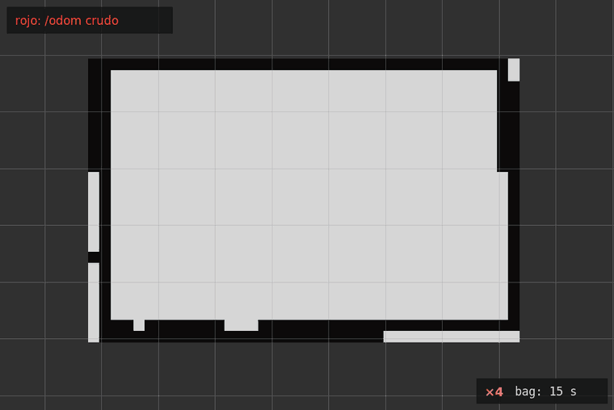

Y así queda al final del bag:

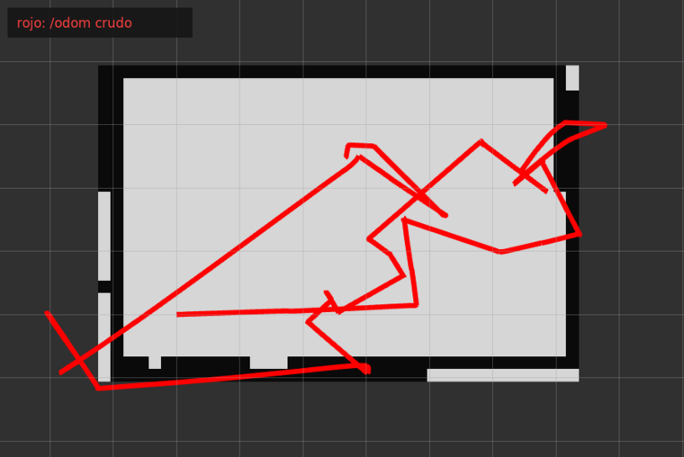

### Teoría: medir la odometría contra sensores que no son las ruedas

`/odom` sale de contar vueltas de las ruedas y convertirlas en metros y
grados. Para saber si esa cuenta está bien hace falta algo que mida lo mismo
**sin usar las ruedas**:

- **El giro, con el IMU.** El giróscopo mide la velocidad de giro del robot
  (`angular_velocity.z`, en rad/s). Integrándola en el tiempo tenés cuánto
  giró, sin importar qué hicieron las ruedas.
- **El avance, con el lidar.** Si el robot avanza en línea recta alejándose
  de una pared, la distancia que mide el lidar hasta esa pared crece justo
  lo que avanzó.

Hay dos tipos de error posibles. Uno es **ruido**: cada medición se equivoca
un poco, para un lado o para el otro. Ese no se corrige con una cuenta, y
para eso está el filtro de partículas del paso 4. El otro es un error de
**escala**: la odometría se equivoca siempre en la misma proporción (por
ejemplo, un radio de rueda mal configurado). Ese sí se mide y se corrige
multiplicando por un factor.

### Qué hacer

**1. Medir con `medir_odometria.py`.** Te lo damos con TODOs:
[`medir_odometria.py`](medir_odometria.py). Copialo a tu paquete,
registralo como ejecutable y completá las tres funciones marcadas:

- `recibir_odom`: sumar el giro según `/odom`, **con signo**.
- `recibir_imu`: integrar la velocidad de giro del IMU.
- `indice_rayo_hacia_atras`: encontrar qué rayo del lidar apunta hacia atrás
  del robot.

El resto ya está. Cada 2 segundos (del bag) imprime una línea así:

```text
bag  14.5 s | giro odom     0.0°  IMU    -0.3°  IMU/odom    nan | avance odom 0.000 m  lidar atrás 0.286 m
```

Sumalo a tu launch y corré el bag entero.

**2. Sacar la escala del giro.** Mirá la última línea: el giro total según
`/odom`, según el IMU y el cociente `IMU/odom`. Fijate el signo, también.

**3. Sacar la escala del avance.** Al principio del bag, el robot está
quieto en el punto de partida y después avanza en línea recta, alejándose de la pared
que tiene detrás. Buscá en las líneas el momento justo antes de que arranque
y el momento en que frena. Compará cuánto avanzó según `/odom` con cuánto
aumentó la distancia del lidar hacia atrás. Ese cociente es la escala del
avance.

**4. Ver la corrección: `odom_corregida.py`.** Este nodo lo escribís vos.
Tiene que:

- Suscribirse a `/odom` y, en cada mensaje, calcular cuánto se movió el
  robot desde el mensaje anterior, **en el frame del robot**: cuánto hacia
  adelante, cuánto hacia el costado (el robot es mecanum) y cuánto giró.
  Ojo con la diferencia de ángulos: normalizala, como en `medir_odometria`.
- Tener dos parámetros, `escala_avance` y `escala_giro`, y multiplicar por
  ellos el avance y el giro de ese paso.
- Ir acumulando una pose corregida (arranca en `(0, 0, 0)`): aplicar el
  avance escalado en la dirección de la pose corregida, no de la de `/odom`,
  y sumarle el giro escalado.
- Publicar dos `nav_msgs/Path` en el frame `map`: `/camino_odom`, con las
  poses tal como vienen en `/odom`, y `/camino_corregido`, con las tuyas.

Es la misma cuenta del modelo de movimiento de tu localizador de la
[semana 06](../semana-06-localizacion/) (`mover_particulas`), sin ruido y
con las dos escalas.

Sumalo a tu launch con `escala_giro` y `escala_avance` como parámetros, y
agregá a tu RViz dos displays `Path`, uno para cada camino, de distinto
color.

> [!WARNING]
> **No republiques `/odom` corregido ni cambies la transformada
> `odom → base_footprint`.** Esa transformada la publica el robot (acá, el
> bag) y todos tus otros nodos la usan para ubicar el lidar y la cámara. Si
> publicás otra versión, tus nodos van a mezclar dos odometrías distintas.
> `odom_corregida` es solo para **mirar** la corrección; en el paso 4 la vas
> a aplicar donde corresponde: dentro del modelo de movimiento del
> localizador.

Las terminales son las mismas del paso 2:

```bash
# Terminal 1 — el bag, en pausa
source ~/rosmaster_ws/install/setup.bash
ros2 bag play ~/rosmaster_ws/bags/laberinto_victimas --clock -p
```

```bash
# Terminal 2 — el mapa
source ~/rosmaster_ws/install/setup.bash
ros2 launch mapa_laberinto mapa.launch.py
```

```bash
# Terminal 3 — tu launch
source ~/rosmaster_ws/install/setup.bash
ros2 launch <tu_paquete> <tu_launch>.launch.py
```

### Qué vas a ver

En la terminal de tu launch, la última línea de `medir_odometria` muestra el
giro total según cada fuente. En RViz, los dos caminos sobre el mapa. Con las
escalas bien medidas, el camino corregido queda dentro de la arena todo el
bag y el de `/odom` se sale (bag a velocidad ×4, desde que el robot arranca):

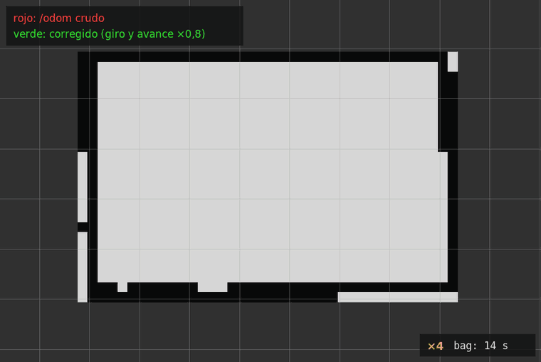

Al final del bag:

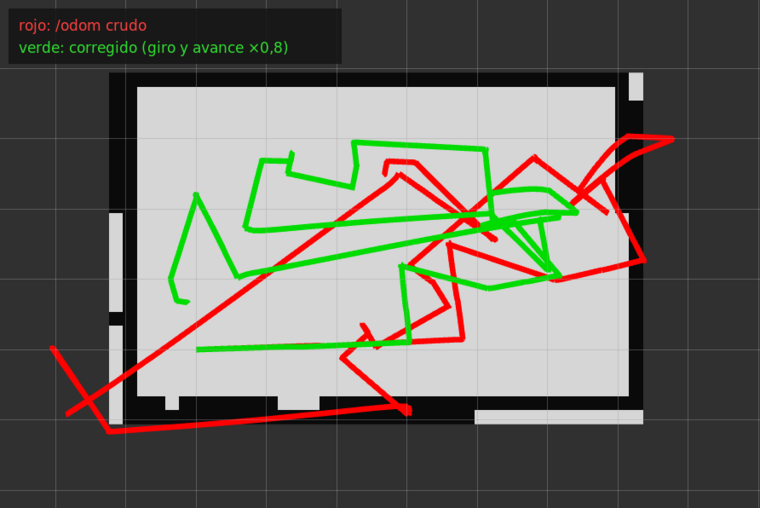

### Comprobación

- Con `escala_giro` y `escala_avance` en 1, los dos caminos coinciden
  exactamente (si no, revisá `odom_corregida`).
- Con tus escalas, el camino corregido queda dentro de la arena todo el bag.

Preguntas:

- ¿Qué signo tiene el cociente `IMU/odom`? ¿Qué te dice eso del IMU? Vas a
  tener que tenerlo en cuenta si alguna vez usás `/imu/data`.
- Cambiá `recibir_odom` **y** `recibir_imu` para que sumen valores
  absolutos en vez de con signo y volvé a correr. ¿Cuánto da el cociente?
  ¿Por qué cambia? (Si cambiás solo uno de los dos, el cociente no significa
  nada.)
- ¿Por qué medimos el avance con el rayo de **atrás** y no con el de
  adelante? (Mirá qué tiene adelante el robot en ese tramo.)
- Compará las dos escalas, la del giro y la del avance. Si dan parecido,
  ¿qué creés que está mal: que las ruedas patinan o algo de cómo se
  calcula la odometría?
- Aun con las dos escalas, el camino corregido no es perfecto. ¿Cuánto
  error le queda? ¿Te alcanza para reportar una víctima a menos de 25 cm?

---

## Paso 4 — Localizar al robot en el mapa

Hasta ahora, `map → odom` estaba fijo en cero: le creías a la odometría.
Ahora lo va a publicar tu filtro de partículas de la
[semana 06](../semana-06-localizacion/), corrigiendo con el lidar contra el
mapa, como hacía en el simulador. La diferencia es que acá la odometría está
mal escalada, y eso cambia todo.

### Teoría: el filtro corrige ruido, no escala

El modelo de movimiento del filtro mueve cada partícula según lo que dice
`/odom`, más un poco de ruido, y después el lidar decide cuáles quedan. Eso
funciona si `/odom` se equivoca **un poco y para cualquier lado**: el ruido
cubre el error y el lidar elige las partículas buenas.

Si `/odom` se equivoca **siempre en la misma proporción**, como acá, todas
las partículas giran de más en cada paso, en la misma dirección. Cuando el
robot gira rápido, el error se acumula más rápido de lo que el lidar llega a
corregirlo, y el filtro se pierde. Con las escalas que mediste en el paso 3,
el modelo de movimiento ya no tiene ese error sistemático y al filtro le
queda solo el ruido, que es lo que sabe corregir.

### Qué hacer

**1. Las escalas en tu localizador.** En el `localizador.py` de tu paquete
`localizacion`, agregá dos parámetros, `escala_giro` y `escala_avance` (por
defecto 1.0), y usalos en `mover_particulas`: multiplicá por
`escala_avance` el avance del paso (las dos componentes, adelante y costado)
y por `escala_giro` el giro, antes de calcular el ruido. Es la misma cuenta
que hiciste en `odom_corregida`.

**2. Tu launch.** Sacá la transformada fija `map → odom`: ahora la publica
el localizador, y si quedan las dos, se pisan. Agregá:

- `campo_verosimilitud` y `localizador` de tu paquete `localizacion`, el
  segundo con `escala_giro` y `escala_avance` en los valores que mediste.
- Para la pose inicial, dejá `(0, 0, 0)` con la dispersión por defecto: el
  robot arranca **cerca** del origen, no exactamente ahí.

Sacá también `odom_corregida` (y `medir_odometria`, que ya cumplió su
trabajo). Tu `localizador` ya publica `/camino_odom` y `/camino_corregido`,
los mismos topics que `odom_corregida`: si quedan los dos nodos, publican
caminos distintos en el mismo topic y los `Path` de RViz se pisan.

Todos con `use_sim_time: True`, como siempre.

**3. Tu RViz.** Agregá un display `PoseArray` en `/particlecloud` para ver
las partículas.

Las terminales son las mismas de antes:

```bash
# Terminal 1 — el bag, en pausa
source ~/rosmaster_ws/install/setup.bash
ros2 bag play ~/rosmaster_ws/bags/laberinto_victimas --clock -p
```

```bash
# Terminal 2 — el mapa
source ~/rosmaster_ws/install/setup.bash
ros2 launch mapa_laberinto mapa.launch.py
```

```bash
# Terminal 3 — tu launch
source ~/rosmaster_ws/install/setup.bash
ros2 launch <tu_paquete> <tu_launch>.launch.py
```

Correlo dos veces: primero con las dos escalas en 1.0 y después con las
tuyas.

### Qué vas a ver

Con las escalas en 1.0, el filtro anda un rato y después de varios giros se
pierde: el lidar se despega del mapa igual que en el paso 1, y al final del
bag el robot queda dado vuelta.

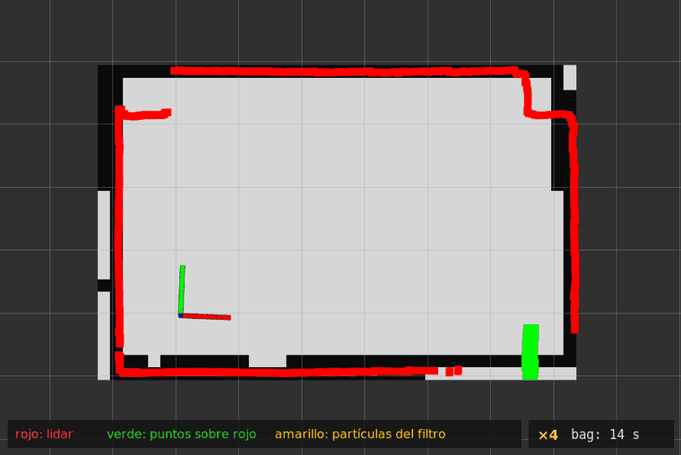

Al final del bag, con las escalas en 1.0:

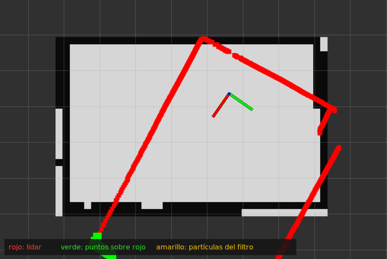

Con tus escalas, el lidar calza con las paredes del mapa durante todo el bag,
las partículas se mantienen juntas alrededor del robot y los puntos de
`/scan_rojo` caen sobre las cajas de las esquinas (bag a velocidad ×4, desde
que el robot arranca):

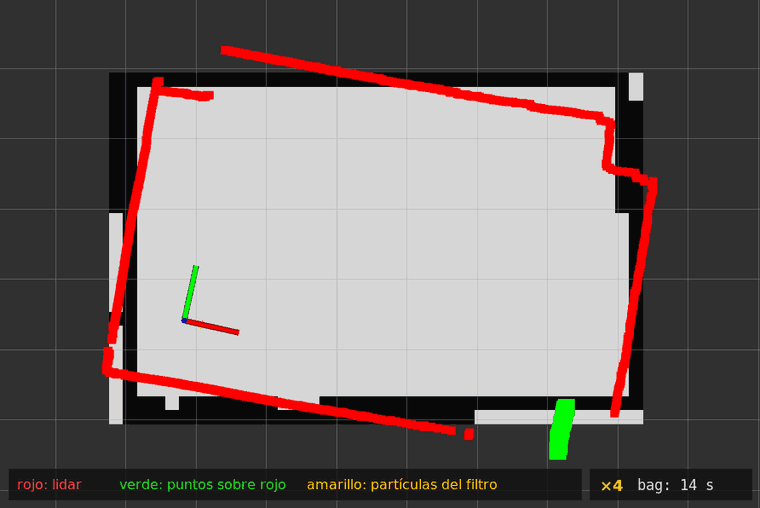

Al final del bag:

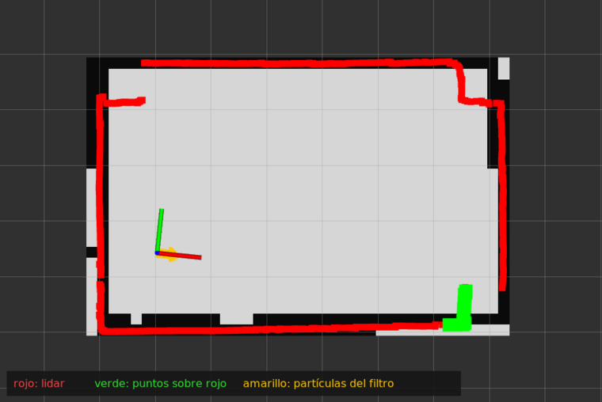

### Comprobación

- Con tus escalas, el lidar calza con el mapa de punta a punta del bag.
- La nube de partículas se mantiene chica, sin partirse en dos grupos.
- Los puntos de `/scan_rojo` caen siempre en las mismas dos esquinas, donde
  están las cajas.

Preguntas:

- Mirá el principio del bag, antes de que el robot arranque. ¿Qué pasa con
  las partículas mientras el robot está quieto? ¿El lidar calza exacto con
  el mapa? Corré el bag dos o tres veces: ¿da siempre lo mismo? (Pista: mirá
  cuánto ruido agrega `mover_particulas` cuando el robot no se movió, y qué
  hace `recibir_scan` en cada scan.)
- Con las escalas en 1.0, ¿en qué momento del bag se pierde el filtro? ¿Qué
  está haciendo el robot justo antes?
- ¿Por qué con las escalas mal el filtro no se arregla solo, si el lidar ve
  las paredes todo el tiempo?
- ¿Qué pasaría si el robot arrancara a 30 cm del origen? ¿Y girado 45°?
  Probalo cambiando `pose_inicial_x` y `pose_inicial_theta`.

### Desafío extra: probar AMCL

En la [semana 09](../semana-09-nav2/) reemplazaste tu filtro por AMCL, el
de Nav2. Probalo contra el bag y comparalo con el tuyo.

AMCL no necesita `map_server`: se suscribe a `/map` y recibe el mismo mapa
que tu localizador. En tu launch, en lugar de `campo_verosimilitud` y
`localizador`, levantá AMCL con la configuración de la semana 09 y un
lifecycle manager que lo active:

```python
Node(package='nav2_amcl', executable='amcl', output='screen',
     parameters=['<ruta a semana-09-nav2/nav2_params.yaml>', {'use_sim_time': True}]),
Node(package='nav2_lifecycle_manager', executable='lifecycle_manager',
     parameters=[{'use_sim_time': True, 'autostart': True, 'node_names': ['amcl']}]),
```

Con el bag en pausa, dale la pose inicial con **2D Pose Estimate** en RViz,
como en la semana 09, y recién después arrancá el bag.

Vas a ver que con esa configuración AMCL también se pierde. Mirá en
`nav2_params.yaml` estos parámetros y pensá cuáles tienen sentido en una
arena de menos de 2 m:

- `update_min_d` y `update_min_a`: cuánto se tiene que mover el robot para
  que AMCL use un scan nuevo.
- `sigma_hit`, `z_hit` y `z_rand`: cuánto confía en que cada punto del
  lidar pega en una pared del mapa.
- `alpha1` a `alpha5`: el ruido de su modelo de movimiento, como tus `gamma`.

Ajustándolos, AMCL mejora bastante, pero en los giros el rumbo se le sigue
atrasando. Pregunta para pensar: ¿por qué AMCL no llega a lo que logra tu
localizador con las escalas? Y si en lugar de un bag tuvieras el robot,
¿dónde corregirías el problema para que AMCL ande bien?

---

## Paso 5 — Llevar las cajas rojas al mapa y reportarlas

Ya tenés todo lo necesario: el robot localizado (paso 4) y los puntos del
lidar que caen sobre rojo (paso 2). Falta pasar de esos puntos a **una
posición por caja, en su centro**, y publicarla en `/victimas`. Al final
vas a ver cuántos puntos sacás.

### Teoría: de los puntos de una cara al centro de la caja

Tu detector de la [semana 07](../semana-07-obstaculos-no-mapeados/), corriendo
sobre `/scan_rojo`, publica un punto por cada racha roja del lidar: el
promedio de los puntos de una cara de la caja. Tiene dos problemas para
reportar:

- **Son muchos.** Cada scan que ve la caja agrega un punto, así que en todo
  el bag son cientos. Hay que juntarlos en uno por caja.
- **Están en la cara, no en el centro.** El lidar ve la cara que mira al
  robot. El centro está media caja más lejos, en la dirección en que el
  robot ve la caja. Con cajas de ~18 cm, son ~9 cm de diferencia.

Juntar con la **mediana** y no con el promedio hace que unos pocos puntos
malos (por ejemplo, los que se corren en un giro, como viste en el paso 2) no
muevan el resultado.

### El evaluador

Para saber si te dio bien, te damos el paquete
[`evaluador_victimas`](evaluador_victimas/). Tiene los centros reales de las
cajas del bag y hace esto:

- Escucha `/victimas` y acepta **solo dos reportes**, porque hay dos cajas
  rojas. Los que lleguen después se ignoran.
- Cada reporte se asigna a la caja roja más cercana. Si está a 0,25 m o
  menos del centro, vale **100 puntos**; hasta 0,5 m, **50**; más lejos, 0.
  Cada caja cuenta una sola vez, con su mejor reporte.
- Un reporte mal formado (`frame_id` distinto de `map`, o una coordenada
  NaN o infinita) gasta un intento y da 0.
- En la terminal escribe cada reporte con su distancia y el puntaje total.
- En RViz (`MarkerArray` en `/evaluador/marcadores`, con `Durability Policy`
  en **Transient Local**) dibuja las cajas reales, las zonas de 0,25 y 0,5 m
  alrededor de cada caja roja, y cada reporte con su número y sus puntos.
  También dibuja la caja azul: un reporte ahí no da puntos.

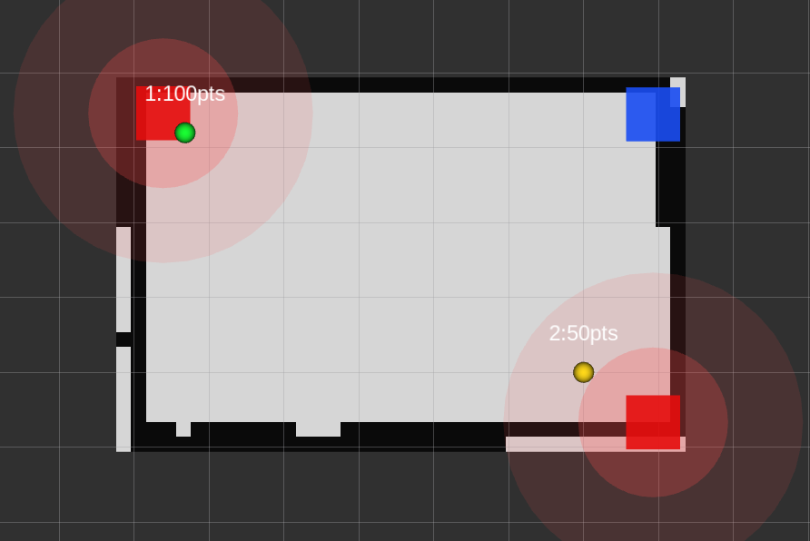

Podés probarlo sin el bag, mandando un reporte a mano:

```bash
source ~/rosmaster_ws/install/setup.bash
ros2 topic pub --once /victimas geometry_msgs/msg/PointStamped "{header: {frame_id: map}, point: {x: 0.5, y: 0.3}}"
```

### Qué hacer

**1. La semana 07 sobre `/scan_rojo`.** Sumá tu `detector_obstaculos` a tu
launch, escuchando `/scan_rojo` en vez de `/scan` y publicando en
`/objetos_rojos` (con `remappings`). Mirá qué detecta con los parámetros de
siempre: casi nada. Las cajas están pegadas a las esquinas, y para el campo
de verosimilitud un punto a 17 cm de una pared "ya está en el mapa". Pero acá
ese filtro sobra: los puntos de `/scan_rojo` ya son rojos. Subí
`umbral_probabilidad` a 101 para que pasen todos.

**2. `juntar_victimas.py`.** Te lo damos con TODOs:
[`juntar_victimas.py`](juntar_victimas.py). Copialo a tu paquete, registralo
como ejecutable y completá las tres funciones marcadas:

- `recibir_objetos`: pasar cada detección de la cara al centro.
- `agregar`: sumarla al grupo que corresponda, o crear uno nuevo.
- `quizas_publicar`: publicar el grupo en `/victimas` cuando junta
  suficientes detecciones.

Sus parámetros:

| Parámetro | Default | Qué es |
|---|---|---|
| `victimas` | 2 | Cuántos reportes publicar como mucho |
| `detecciones_minimas` | 30 | Cuántas detecciones tiene que juntar un grupo antes de publicarlo |
| `radio_grupo` | 0.30 | Distancia máxima (m) a la mediana de un grupo para sumarse a él |
| `mitad_caja` | 0.09 | Cuánto correr cada detección de la cara al centro (m) |

Sumalo a tu launch.

**3. El evaluador.** Compilá `evaluador_victimas` y sumá a tu RViz un
`MarkerArray` en `/evaluador/marcadores` (Transient Local). El evaluador va en
su propia terminal, como el mapa: no es parte de tu código.

```bash
source ~/rosmaster_ws/install/setup.bash
cd ~/rosmaster_ws
colcon build --packages-select evaluador_victimas
```

Las terminales ahora son cuatro:

```bash
# Terminal 1 — el bag, en pausa
source ~/rosmaster_ws/install/setup.bash
ros2 bag play ~/rosmaster_ws/bags/laberinto_victimas --clock -p
```

```bash
# Terminal 2 — el mapa
source ~/rosmaster_ws/install/setup.bash
ros2 launch mapa_laberinto mapa.launch.py
```

```bash
# Terminal 3 — el evaluador
source ~/rosmaster_ws/install/setup.bash
ros2 launch evaluador_victimas evaluador.launch.py
```

```bash
# Terminal 4 — tu launch
source ~/rosmaster_ws/install/setup.bash
ros2 launch <tu_paquete> <tu_launch>.launch.py
```

> [!NOTE]
> **Si el puntaje te da peor de una corrida a otra, mirá la carga de tu
> computadora.** El localizador está en Python: si la computadora está muy
> cargada (por ejemplo, grabando la pantalla, o con el bag a velocidad ×2),
> se atrasa en los giros y las posiciones salen corridas. Corré el bag a
> velocidad normal.

> [!NOTE]
> **El evaluador no se reinicia solo.** Cuando usa sus dos reportes, ignora
> todo lo que llegue después, aunque vuelvas a correr el bag desde el
> principio. Antes de cada corrida, cerrá la Terminal 3 y volvé a abrirla.

### Qué vas a ver

La primera caja se reporta a los pocos segundos, con el robot todavía quieto
en el punto de partida; la segunda, después de que el robot la ve de cerca.
Cada reporte aparece en RViz con sus puntos, y a la derecha está lo que ve la
cámara en cada momento (bag a velocidad ×4):

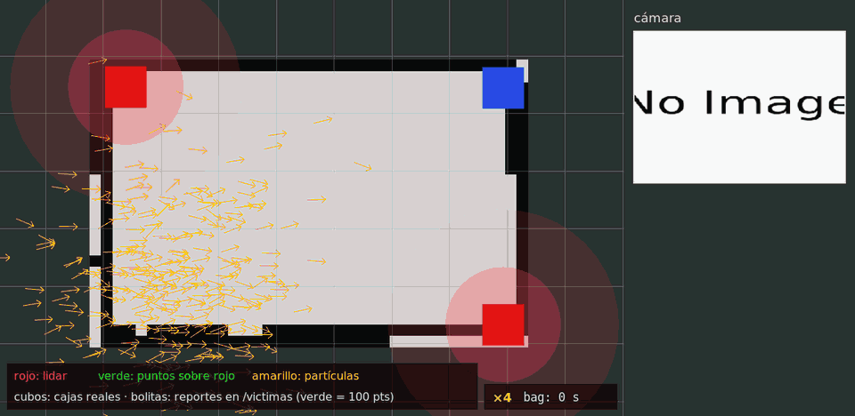

Al final del bag:

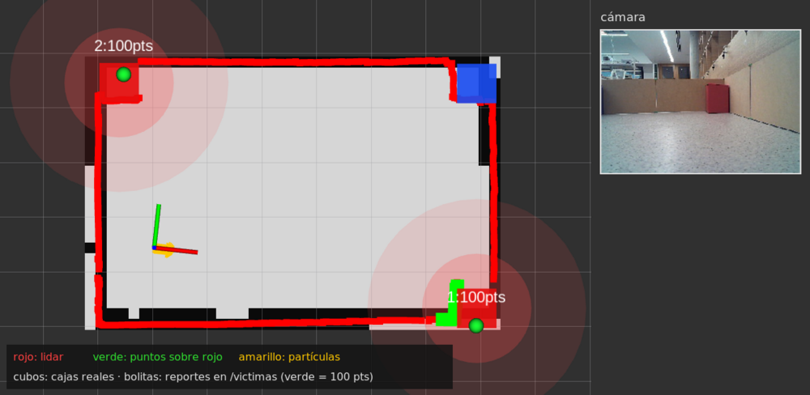

En la terminal del evaluador vas a ver algo así:

```text
Reporte 1/2 en (...): a 0.079 m de la caja roja 2.
Puntaje: 100 de 200 (1/2 reportes usados)
Reporte 2/2 en (...): a 0.043 m de la caja roja 1.
Puntaje: 200 de 200 (2/2 reportes usados)
```

### Comprobación

- Los dos reportes caen dentro de la zona de 0,25 m de su caja: 200 de 200.
- Ningún reporte cae sobre la caja azul.
- Tu nodo publica exactamente dos veces: no hay "Reporte ignorado" en el
  evaluador.

Preguntas:

- Corré con `mitad_caja` en 0. ¿A qué distancia del centro quedan los
  reportes? ¿Para qué lado se corren y por qué?
- La caja que se reporta primero suele quedar más lejos del centro que la
  otra. ¿Por qué? (Pensá en lo que viste en el paso 4 con el robot quieto.)
- ¿Qué pasa con `detecciones_minimas` en 5? ¿Y en 200? ¿Qué ganás y qué
  perdés en cada caso?
- Cambiá la mediana por el promedio en `agregar` y `quizas_publicar`.
  ¿Cambia el resultado? ¿En qué caso cambiaría mucho?
- Si tu detector de rojo confundiera la caja azul con una roja, ¿qué
  reportaría `juntar_victimas`? ¿Cuántos puntos perderías?
