# Semana 10: Del simulador al robot real

## Objetivo

Todo lo que armaste hasta ahora corrió contra el simulador. Un robot real
no se comporta igual: la cámara ve otra luz, la imagen se mueve cuando el
robot gira y la odometría acumula error. Este último workshop usa **un bag
grabado con el robot real** en un laberinto con cajas, y el objetivo es
**ubicar en el mapa el centro de cada caja roja**.

No hace falta el robot ni el simulador: el bag reemplaza a los dos. El mapa
lo vas a recibir publicado en `/map`, y es un mapa del laberinto **vacío**:
las cajas no están ahí.

Casi no vas a escribir código nuevo. Vas a reusar lo que ya tenés de las
semanas [04](../semana-04-deteccion-color/),
[06](../semana-06-localizacion/) y
[07](../semana-07-obstaculos-no-mapeados/), y el trabajo es descubrir
**qué deja de funcionar** al pasar de lo simulado a lo real, y por qué.

El workshop tiene cinco pasos:

1. Levantar el bag y recibir el mapa.
2. Detectar lo rojo con la cámara real, y los puntos del lidar que caen
   sobre eso.
3. Medir cuánto se equivoca la odometría.
4. Localizar al robot en el mapa.
5. Llevar las cajas rojas al mapa y reportarlas en `/victimas`.

Necesitás las semanas [04](../semana-04-deteccion-color/),
[05](../semana-05-launch-rviz/), [06](../semana-06-localizacion/) y
[07](../semana-07-obstaculos-no-mapeados/) completas.

---

## Teoría: qué cambia del simulador al robot real

En el simulador, cada sensor mide exactamente lo que el modelo dice que
tiene que medir, más un ruido prolijo. En el robot real aparecen cosas que
el modelo no tiene:

- **La cámara** ve con la luz del lugar, con reflejos y sombras, y cuando
  el robot gira rápido la imagen sale movida. Además ve todo lo que hay
  alrededor del laberinto: gente, muebles, otros objetos. Los rangos de HSV
  que calibraste en el simulador pueden andar o no.
- **La odometría** sale de contar vueltas de las ruedas. Las ruedas mecanum
  patinan un poco en cada giro y la cuenta se aleja de a poco de lo que el
  robot hizo de verdad. Cada error es chico, pero nadie lo corrige: se va
  sumando durante todo el recorrido.
- **La pose de partida** es "cerca del origen": al robot lo ubica una
  persona a mano, así que no arranca exactamente en `(0, 0, 0)`.
- **Los objetos** no son cubos perfectos de un solo color. Hay cajas rojas y
  azules, conos azules, una pared con ventanas, y una caja que quedó
  apoyada torcida contra la pared.

Lo que **no** cambia es la geometría: el simulador está armado con las
medidas del robot real. La cámara tiene la misma resolución (320 × 240) y
los mismos intrínsecos, y el lidar está montado igual (girado 180°, en los
dos). Si algo de tu código anda en el simulador y no acá, no busques por ese
lado.

Nada de esto se arregla con un parámetro mágico: primero hay que verlo, y
el bag te deja verlo las veces que quieras, siempre con los mismos datos.

---

## Teoría: qué es un bag

Un **bag** es una grabación de topics. `ros2 bag record` se suscribe a los
topics que le pedís y guarda cada mensaje que llega, con la hora en que
llegó, en una carpeta. `ros2 bag play` hace lo inverso: lee esa carpeta y
vuelve a publicar los mismos mensajes, en los mismos topics y con el mismo
ritmo con que se grabaron.


Para tus nodos no hay diferencia: se suscriben a `/scan` o a `/odom` y
reciben mensajes, sin saber si vienen del robot o del bag. Por eso un bag
sirve para probar tu código contra datos reales sin tener el robot, y
para repetir **exactamente** la misma corrida todas las veces que haga
falta, cosa que con el robot no se puede.

La carpeta del bag tiene dos archivos:

- `metadata.yaml`: qué topics hay, de qué tipo, cuántos mensajes y con qué
  QoS se publicaron. Por eso, al reproducir, el lidar y la cámara salen otra
  vez en *Best Effort*.
- `laberinto_victimas_0.db3`: los mensajes en sí (una base de datos SQLite).

Antes de reproducir un bag, mirá qué tiene adentro:

```console
$ ros2 bag info laberinto_victimas
Duration:          183.988689429s
Messages:          24890
Topic information: Topic: /tf_static | Type: tf2_msgs/msg/TFMessage | Count: 2
                   Topic: /tf | Type: tf2_msgs/msg/TFMessage | Count: 3680
                   Topic: /scan | Type: sensor_msgs/msg/LaserScan | Count: 1371
                   Topic: /odom | Type: nav_msgs/msg/Odometry | Count: 1840
                   Topic: /joint_states | Type: sensor_msgs/msg/JointState | Count: 1840
                   Topic: /cam_1/color/camera_info | Type: sensor_msgs/msg/CameraInfo | Count: 5512
                   Topic: /cam_1/color/image_raw | Type: sensor_msgs/msg/Image | Count: 5494
                   Topic: /imu/data | Type: sensor_msgs/msg/Imu | Count: 1840
                   Topic: /cmd_vel | Type: geometry_msgs/msg/Twist | Count: 3311
```

(La salida real trae algunas líneas y columnas más; acá quedaron las
importantes.)
Con la cantidad de mensajes y la duración sacás la frecuencia de cada
topic: 1371 scans en 184 s son unos 7,5 Hz.

**El reloj.** Cada mensaje trae en su `header.stamp` la hora de la
grabación, no la de ahora. Si tus nodos usan el reloj de tu computadora,
esas horas no coinciden con nada y tf2 no puede cruzar los datos del bag
con lo que publican tus nodos. Para eso están dos piezas que van juntas:

- `ros2 bag play --clock` publica en `/clock` la hora de la grabación,
  avanzando al ritmo del bag.
- `use_sim_time:=true` en cada nodo hace que use `/clock` en vez del reloj
  de la computadora.

Es el mismo mecanismo que usa Gazebo: el simulador también publica
`/clock`, y por eso venías usando `use_sim_time`.

Para leer más:

- [Recording and playing back data](https://docs.ros.org/en/humble/Tutorials/Beginner-CLI-Tools/Recording-And-Playing-Back-Data/Recording-And-Playing-Back-Data.html),
  el tutorial oficial de ROS 2 Humble (record, play, info, con turtlesim).
- [Clock and Time](https://design.ros2.org/articles/clock_and_time.html),
  el diseño del reloj de ROS 2: qué es `use_sim_time` y cómo funciona `/clock`.

---

## Material

| Archivo | Qué es |
|---|---|
| `laberinto_victimas/` | Bag de 3 minutos grabado en el robot real, en el laberinto con cajas. Se baja de la [release `semana-10-datos`](https://github.com/AIRclub-UdeSA/jar_workshops/releases/tag/semana-10-datos) (≈ 760 MB comprimido, ≈ 1,2 GB descomprimido). |
| [`mapa_laberinto/mapas/laberinto_vacio.yaml`](mapa_laberinto/mapas/laberinto_vacio.yaml) | Mapa del mismo laberinto **sin cajas** (≈ 2,8 × 4,2 m, 3 cm por celda). Ya viene en el paquete. |

Topics del bag:

| Topic | Qué trae |
|---|---|
| `/scan` | Lidar, 7,5 Hz, **Best Effort** |
| `/odom` | Odometría de las ruedas, 10 Hz |
| `/imu/data` | IMU, 10 Hz |
| `/tf`, `/tf_static` | Árbol de transformadas del robot (`odom → base_footprint → ...`) |
| `/cam_1/color/image_raw` | Cámara a color, 30 Hz, 320 × 240, **Best Effort** |
| `/cam_1/color/camera_info` | Intrínsecos de la cámara |
| `/cmd_vel`, `/joint_states` | Lo que se le mandó al robot y el estado de las ruedas |

El bag **no tiene `/map` ni la transformada `map → odom`**: el mapa lo
publica el paquete de esta semana, y `map → odom` lo vas a publicar vos cuando localices al robot (paso 4).

Tampoco tiene profundidad: para saber a qué distancia está algo que ve la
cámara, vas a usar el lidar, igual que en la semana 04.

---

## Antes de empezar: el paquete `mapa_laberinto`

Este paquete ya viene armado. Tiene un solo nodo, `publicar_mapa`, que
publica el mapa **una vez** en `/map`, con QoS *reliable* + *transient local* y
`frame_id: map`. Como queda retenido, tus nodos lo reciben aunque arranquen
después. No publica ninguna transformada: ubicarse en el mapa es trabajo
tuyo.

```bash
source ~/rosmaster_ws/install/setup.bash
cd ~/rosmaster_ws
colcon build --packages-select mapa_laberinto
```

Bajá el bag y descomprimilo en `~/rosmaster_ws/bags/` (si lo dejás en otro
lado, cambiá la ruta en los comandos de abajo):

```bash
source ~/rosmaster_ws/install/setup.bash
mkdir -p ~/rosmaster_ws/bags && cd ~/rosmaster_ws/bags
curl -L -O https://github.com/AIRclub-UdeSA/jar_workshops/releases/download/semana-10-datos/laberinto_victimas.tar.gz
tar xzf laberinto_victimas.tar.gz
ros2 bag info laberinto_victimas
```

Queda una carpeta `laberinto_victimas/` con dos archivos: `metadata.yaml` y
`laberinto_victimas_0.db3`.

---

## Paso 1: Levantar el bag y recibir el mapa

### Qué hacer

Abrí cuatro terminales.
**El orden importa** (ver el aviso de abajo): primero el bag, en pausa.

```bash
# Terminal 1: el bag, en pausa (-p). Ya publica su reloj en /clock
source ~/rosmaster_ws/install/setup.bash
ros2 bag play ~/rosmaster_ws/bags/laberinto_victimas --clock -p
```

```bash
# Terminal 2: el mapa
source ~/rosmaster_ws/install/setup.bash
ros2 launch mapa_laberinto mapa.launch.py
```

```bash
# Terminal 3: map → odom fijo en cero (provisorio, ver abajo)
source ~/rosmaster_ws/install/setup.bash
ros2 run tf2_ros static_transform_publisher --frame-id map --child-frame-id odom --ros-args -p use_sim_time:=true
```

```bash
# Terminal 4: tu RViz
source ~/rosmaster_ws/install/setup.bash
rviz2 --ros-args -p use_sim_time:=true
```

Con todo abierto, volvé a la Terminal 1 y apretá la **barra espaciadora**
para que el bag arranque. La misma tecla lo pausa y lo despausa.

`--clock` hace que el bag publique su propio reloj en `/clock`, y
`use_sim_time:=true` hace que cada nodo use ese reloj en vez del de tu
computadora (ver "Teoría: qué es un bag").

> [!WARNING]
> **Si el mapa desaparece de RViz cuando arranca el bag, es el reloj.** Un
> nodo con `use_sim_time:=true` que arrancó antes que `/clock` ve la hora
> saltar de 0 a la hora de la grabación, y RViz se reinicia solo
> (`Detected jump back in time. Resetting RViz.` en la terminal). El mapa se
> publica una sola vez, así que puede no volver a aparecer. Por eso el bag
> va primero y en pausa: cuando RViz arranca, `/clock` ya tiene la hora de la
> grabación y no hay salto. Si te pasa igual (por ejemplo, al volver a
> correr el bag desde el principio), cerrá RViz y la Terminal 2 y volvé a
> abrirlas.

La Terminal 3 es una trampa a propósito: dice "el robot arrancó
exactamente en el origen del mapa y la odometría nunca se equivoca". Sin
eso no hay forma de dibujar el lidar sobre el mapa, porque nadie publica
`map → odom`. **Cuando localices al robot (paso 4) la vas a cerrar**,
porque tu localizador publica esa misma transformada y las dos se pisarían.

Armá el RViz como en la [semana 05](../semana-05-launch-rviz/):

- `Fixed Frame` en `map`.
- `Map` en `/map`, con `Durability Policy` en **Transient Local** (mismo
  ajuste que en la [semana 06](../semana-06-localizacion/)).
- `LaserScan` en `/scan`.
- `Image` en `/cam_1/color/image_raw`.
- Dos displays `Axes`: uno con `Reference Frame` en `odom` y otro en
  `base_footprint`, para ver dónde cree el robot que está. (El display `TF`
  también sirve, pero muestra cada rueda y cada sensor y tapa al robot.)

Guardá la configuración (`File → Save Config As`): la vas a usar en todos
los pasos que siguen.

> [!WARNING]
> **Si la imagen o el lidar no aparecen, es la QoS.** El robot publica la
> cámara y el lidar en **Best Effort**, y un display de RViz puede quedar
> suscripto en *Reliable*. Un suscriptor *reliable* no se conecta con un
> publicador *best effort*, y no avisa. Abrí la sección `Topic` de cada
> display y poné `Reliability Policy` en **Best Effort**. En tu código pasa
> lo mismo: por eso te suscribís con `qos_profile_sensor_data`.

### Qué vas a ver

Al principio, con el robot quieto en el punto de partida, el lidar calza
con las paredes del mapa y la cámara muestra la pared que el robot tiene
adelante:

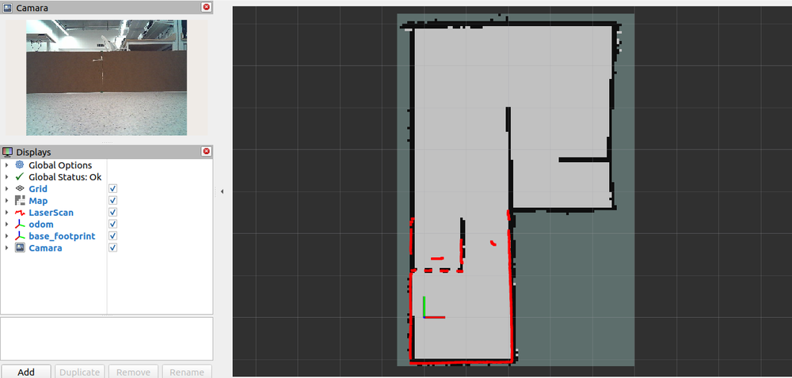

Durante los primeros dos minutos el lidar sigue calzando con el mapa,
aunque cada vez un poco peor. En el último minuto ya quedó girado unos
grados y corrido respecto de las paredes:

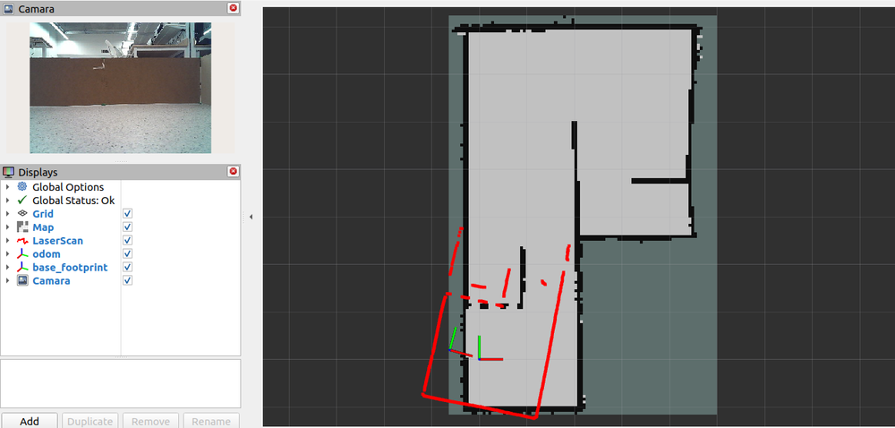

El bag entero, acelerado unas 12 veces:

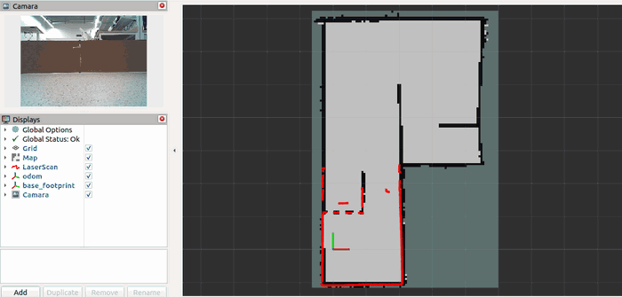

### Comprobación

- En la Terminal 2 aparece `Mapa publicado en /map: 94x140 celdas`.
- RViz muestra el mapa, el lidar y la imagen de la cámara.
- Con `ros2 topic info /cam_1/color/image_raw --verbose` podés ver la QoS
  con la que publica el bag.

Antes de seguir, contestate estas preguntas mirando el bag (podés pausarlo
con la barra espaciadora en la Terminal 1):

- Con el robot todavía quieto, ¿el lidar calza con las paredes? ¿Qué te
  dice eso sobre la pose de partida?
- En el lidar aparecen formas que el mapa no tiene. ¿Qué son? Buscalas en
  la cámara.
- Recorré el bag entero. ¿En qué momento el lidar empieza a despegarse del
  mapa? ¿Se despega de golpe o de a poco?
- Si la Terminal 3 dice "la odometría nunca se equivoca", ¿qué te está
  mostrando RViz cuando el lidar no calza?

---

## Paso 2: Detectar el rojo con la cámara real

En la [semana 04](../semana-04-deteccion-color/) armaste dos nodos contra
el simulador: `detector` (parte 1), que decide si la cámara ve un cuadrado
rojo y publica `/rojo_detectado`, y `detector_scan` (parte 2), que proyecta
cada punto del lidar sobre la imagen y publica en `/scan_rojo` solo los que
caen sobre rojo. Ahora los vas a correr **sin cambiar nada** contra el robot
real y vas a comprobar qué se transfiere y qué no.

Además vas a hacer dos cosas nuevas: ver en RViz la máscara que calcula tu
detector, y armar **tu launch**, el que va a ir creciendo en cada
paso.

### Qué hacer

**1. Publicar la máscara.** Tu `detector` calcula una máscara (blanco donde
ve rojo, negro en el resto) y la usa solo por dentro. Publicala como imagen
para poder verla en RViz. En `detector.py`:

- En `__init__`, creá un publisher de `sensor_msgs/Image` en `mascara_rojo`
  y una variable `self.ultimo_header = None`.
- En `recibir_imagen`, guardá `msg.header` en `self.ultimo_header`.
- En `hay_cuadrado_rojo`, después de calcular la máscara, convertila con
  `self.puente.cv2_to_imgmsg(mascara, encoding='mono8')`, poné
  `self.ultimo_header` como `header` del mensaje y publicalo.

`mono8` es una imagen de un solo canal, de 0 a 255: justo lo que es una
máscara. Volvé a compilar `deteccion_color`.

**2. Tu launch.** En tu propio paquete (el que armaste desde la
[semana 05](../semana-05-launch-rviz/)), creá un launch que levante:

- la transformada fija `map → odom` en cero del paso 1, ahora como nodo del
  launch (`package='tf2_ros'`, `executable='static_transform_publisher'`,
  `arguments=['--frame-id', 'map', '--child-frame-id', 'odom']`);
- `detector` y `detector_scan` del paquete `deteccion_color`;
- `rviz2` con la configuración que guardaste en el paso 1 (`arguments=['-d', <ruta>]`).

Todos con `parameters=[{'use_sim_time': True}]`. Si te falta uno, ese nodo
usa el reloj de tu computadora y no cruza bien con los datos del bag.

El bag y el mapa **no** van en tu launch: el bag hace de robot y el mapa
viene de afuera. Así, tu launch tiene solo lo tuyo, lo mismo que correrías
con el robot real.

**3. Sumá a tu RViz** un `LaserScan` en `/scan_rojo` (de otro color y con
puntos más grandes que el `/scan`) y un segundo `Image` en `/mascara_rojo`.
Guardá la configuración.

Ahora alcanza con tres terminales:

```bash
# Terminal 1: el bag, en pausa
source ~/rosmaster_ws/install/setup.bash
ros2 bag play ~/rosmaster_ws/bags/laberinto_victimas --clock -p
```

```bash
# Terminal 2: el mapa
source ~/rosmaster_ws/install/setup.bash
ros2 launch mapa_laberinto mapa.launch.py
```

```bash
# Terminal 3: tu launch (cambiá paquete y nombre por los tuyos)
source ~/rosmaster_ws/install/setup.bash
ros2 launch <tu_paquete> <tu_launch>.launch.py
```

Cuando abra RViz, apretá la barra espaciadora en la Terminal 1.

> [!NOTE]
> **Para mirar un tramo del bag, no uses `--start-offset`.** `/tf_static`
> (las transformadas fijas del robot: dónde están el lidar y la cámara) se
> publica una sola vez, al principio del bag. Si arrancás más adelante te lo
> salteás y RViz no puede dibujar el lidar. Reproducí desde el principio y
> cambiá la velocidad: `-r 2` al lanzarlo, o las flechas ↑ ↓ en la Terminal 1
> mientras corre.

### Qué vas a ver

A la izquierda, arriba la cámara y abajo la máscara: una mancha blanca con
la forma de la caja y todo lo demás negro. En el mapa, los puntos de
`/scan_rojo` (en verde) caen sobre la cara de la caja que mira al robot:

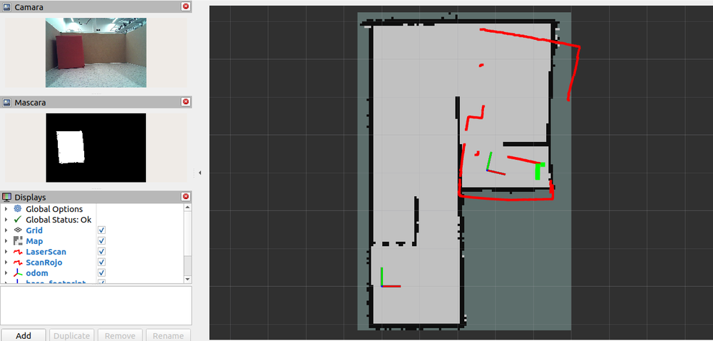

### Comprobación

- `ros2 topic echo /rojo_detectado` muestra `data: true` mientras se ve una
  caja. Cuando no ve ninguna, el topic queda callado: tu detector solo
  publica `True`.
- `ros2 topic hz /mascara_rojo` publica a la frecuencia del timer de tu
  detector.
- En RViz, los puntos verdes aparecen sobre las cajas rojas.

Preguntas para contestarte mirando el bag:

- ¿Tuviste que cambiar los rangos de HSV o el área mínima para que el
  detector ande con la cámara real? ¿Por qué creés que sí o que no?
- En el bag hay conos azules, una caja azul y gente al fondo. ¿Alguno
  aparece en la máscara?
- `detector_scan` nunca supo cómo está montado el lidar en el robot. ¿Cómo
  sabe dónde cae cada rayo en la imagen?
- Recorré el bag entero. ¿Aparecen puntos verdes que **no** están sobre una
  caja roja? ¿Qué está haciendo el robot en esos momentos?

### Desafío extra: no confiar en el rojo mientras el robot gira

Si miraste bien la última pregunta, viste esto: cuando el robot gira rápido,
los puntos verdes se "corren" por la pared al lado de la caja (bag a
velocidad ×0,5):

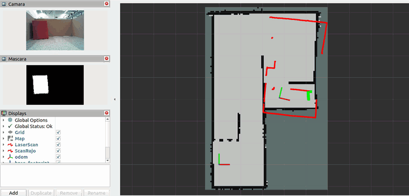

La causa está en cómo `detector_scan` junta los dos sensores: en cada scan
usa **la última imagen que llegó**, sin mirar de qué momento es. Y un scan
no es un instante: el lidar tarda unos 0,13 s en dar una vuelta (es el
`scan_time` del mensaje). El `header.stamp` del scan marca cuándo
**empezó** esa vuelta, pero el mensaje sale recién cuando termina. La imagen,
en cambio, llega casi apenas se toma. Por eso, en este bag, la última imagen
tiene un `header.stamp` unos 0,11 s **posterior** al del scan: es de cerca
del final de la vuelta. Con el robot quieto no importa. Girando a 50°/s, en
0,13 s el robot gira unos 6,5°: los rayos del principio de la vuelta miraron
para un lado y la imagen es de cuando el robot ya miraba para otro. A 2 m de
distancia, unos 5° corren el punto unos 20 cm.

El desafío: que `detector_scan` no marque ningún punto como rojo mientras el
robot gira más rápido que un umbral.

- Suscribite a `/odom` y guardá la velocidad de giro
  (`msg.twist.twist.angular.z`), igual que guardás la última imagen.
- Agregá un parámetro `giro_maximo` (en rad/s; con 0, el filtro apagado).
- En `recibir_scan`, si `abs(giro) > giro_maximo`, publicá el scan sin
  ningún punto rojo.

Empezá con `giro_maximo` en 0,3 rad/s y probá otros valores. Mirá dos cosas:
cuántos puntos verdes siguen cayendo sobre la pared, y cuántos puntos buenos
perdés. Si el umbral es muy bajo, también tirás puntos de cuando el robot
gira despacio mirando la caja.

Pregunta para pensar: la solución "de libro" sería juntar cada scan con la
imagen de su mismo instante, comparando los `header.stamp`. En este bag,
¿alcanzaría? (Pista: para cada sensor, compará la hora a la que llega el
mensaje con su `header.stamp`, y fijate cuánto dura una vuelta del lidar.
¿A qué instante corresponde el `header.stamp` de un scan?)

---

## Paso 3: Medir cuánto se equivoca la odometría

En el paso 1 viste que, con `map → odom` fijo en cero, el lidar calza con
el mapa casi todo el bag pero al final se despega. Esa transformada fija
dice "la odometría nunca se equivoca", así que lo que viste es **el error de
la odometría**. Ahora lo vas a medir: cuánto se equivoca y de qué tipo es
ese error.

### Teoría: medir la odometría contra sensores que no son las ruedas

`/odom` sale de contar vueltas de las ruedas y convertirlas en metros y
grados. Para saber si esa cuenta está bien hace falta algo que mida lo mismo
**sin usar las ruedas**:

- **El giro, con el IMU.** El giróscopo mide la velocidad de giro del robot
  (`angular_velocity.z`, en rad/s). Integrándola en el tiempo tenés cuánto
  giró, sin importar qué hicieron las ruedas.
- **El avance, con el lidar.** Si el robot avanza en línea recta alejándose
  de una pared, la distancia que mide el lidar hasta esa pared crece justo
  lo que avanzó.

Hay dos tipos de error posibles. Uno es de **escala**: la odometría se
equivoca siempre en la misma proporción, por ejemplo por un radio de rueda
mal configurado. Ese se nota enseguida, se mide y se corrige multiplicando
por un factor. El otro es **ruido**: cada giro y cada tramo se equivocan un
poco, a veces para un lado y a veces para el otro. Ese no se corrige con una
cuenta, y para eso está el filtro de partículas del paso 4.

### Qué hacer

**1. Medir con `medir_odometria.py`.** Te lo damos con TODOs:
[`medir_odometria.py`](medir_odometria.py). Copialo a tu paquete,
registralo como ejecutable y completá las tres funciones marcadas:

- `recibir_odom`: sumar el giro según `/odom`, **con signo**.
- `recibir_imu`: integrar la velocidad de giro del IMU.
- `indice_rayo_hacia_atras`: encontrar qué rayo del lidar apunta hacia atrás
  del robot.

El resto ya está. Cada 2 segundos (del bag) imprime una línea así:

```text
bag  18.4 s | giro odom   119.0°  IMU  -118.8°  IMU/odom -0.998 | avance odom 0.688 m  lidar atrás 0.686 m
```

Sumalo a tu launch y corré el bag entero. Las terminales son las mismas del
paso 2:

```bash
# Terminal 1: el bag, en pausa
source ~/rosmaster_ws/install/setup.bash
ros2 bag play ~/rosmaster_ws/bags/laberinto_victimas --clock -p
```

```bash
# Terminal 2: el mapa
source ~/rosmaster_ws/install/setup.bash
ros2 launch mapa_laberinto mapa.launch.py
```

```bash
# Terminal 3: tu launch
source ~/rosmaster_ws/install/setup.bash
ros2 launch <tu_paquete> <tu_launch>.launch.py
```

**2. El giro.** Mirá la última línea: el giro total según `/odom`, según el
IMU y el cociente `IMU/odom`. Fijate el signo, también. Después mirá las
líneas de antes y de después de cada giro grande y calculá el cociente de
ese giro solo.

**3. El avance.** Al principio del bag, el robot está quieto unos segundos
en el punto de partida y después avanza en línea recta, alejándose de la
pared que tiene detrás. Buscá en las líneas el momento justo antes de que
arranque y el momento en que frena. Compará cuánto avanzó según `/odom` con
cuánto aumentó la distancia del lidar hacia atrás.

**4. El error que queda.** Volvé a mirar el final del bag con tu RViz del
paso 2 (con `map → odom` fijo). Estimá cuánto quedó girado el lidar respecto
del mapa y cuánto quedó corrido el robot.

### Comprobación

- El cociente `IMU/odom` de la última línea está cerca de 1 en valor
  absoluto.
- El avance según `/odom` y según el lidar difieren en menos de 2 cm.

Preguntas:

- ¿Qué signo tiene el cociente `IMU/odom`? ¿Qué te dice eso del IMU? Vas a
  tener que tenerlo en cuenta si alguna vez usás `/imu/data`.
- ¿La odometría tiene un error de escala? ¿Te convendría multiplicar el
  giro o el avance por algún factor?
- El cociente de cada giro, ¿es siempre el mismo? Si cada giro se equivoca
  un 2 % para un lado o para el otro, ¿cuánto error de rumbo podés juntar
  después de girar más de 700°?
- Con 5° de error de rumbo, ¿cuánto se corre un punto que el lidar ve a 2 m?
  ¿Coincide con lo que viste en el paso 1?
- ¿Te alcanza con `/odom` para reportar una caja a menos de 25 cm de su
  centro? ¿Y si la caja se ve recién al final del bag?

---

## Paso 4: Localizar al robot en el mapa

Hasta ahora, `map → odom` estaba fijo en cero: le creías a la odometría.
Ahora lo va a publicar tu filtro de partículas de la
[semana 06](../semana-06-localizacion/), corrigiendo con el lidar contra el
mapa, como hacía en el simulador.

### Teoría: por qué el filtro sí corrige este error

El modelo de movimiento del filtro mueve cada partícula según lo que dice
`/odom`, más un poco de ruido. Después el lidar decide cuáles quedan: las
que ven las paredes del mapa donde el lidar dice que están. Eso funciona si
`/odom` se equivoca **un poco y para cualquier lado**, que es lo que mediste
en el paso 3: el ruido de las partículas cubre ese error y el lidar elige
las buenas en cada scan. Así el error no se acumula: se corrige varias
veces por segundo, mientras el robot vea paredes.

### Qué hacer

**1. Tu launch.** Sacá la transformada fija `map → odom`: ahora la publica
el localizador, y si quedan las dos, se pisan. Sacá también
`medir_odometria`, que ya cumplió su trabajo. Agregá `campo_verosimilitud`
y `localizador` de tu paquete `localizacion`, tal como los dejaste en la
semana 06.

Para la pose inicial, dejá `(0, 0, 0)` con la dispersión por defecto: el
robot arranca **cerca** del origen, no exactamente ahí.

Todos con `use_sim_time: True`, como siempre.

**2. Tu RViz.** Agregá un display `PoseArray` en `/particlecloud` para ver
las partículas.

Las terminales son las mismas de antes:

```bash
# Terminal 1: el bag, en pausa
source ~/rosmaster_ws/install/setup.bash
ros2 bag play ~/rosmaster_ws/bags/laberinto_victimas --clock -p
```

```bash
# Terminal 2: el mapa
source ~/rosmaster_ws/install/setup.bash
ros2 launch mapa_laberinto mapa.launch.py
```

```bash
# Terminal 3: tu launch
source ~/rosmaster_ws/install/setup.bash
ros2 launch <tu_paquete> <tu_launch>.launch.py
```

### Qué vas a ver

Con tu localizador, el lidar calza con las paredes del mapa durante todo el
bag, las partículas se mantienen juntas alrededor del robot y los puntos de
`/scan_rojo` caen siempre sobre las cajas (bag a velocidad ×4):

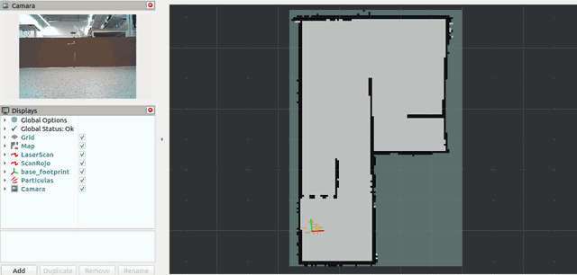

Al final del bag, a la izquierda con `map → odom` fijo (paso 1) y a la
derecha con tu localizador:

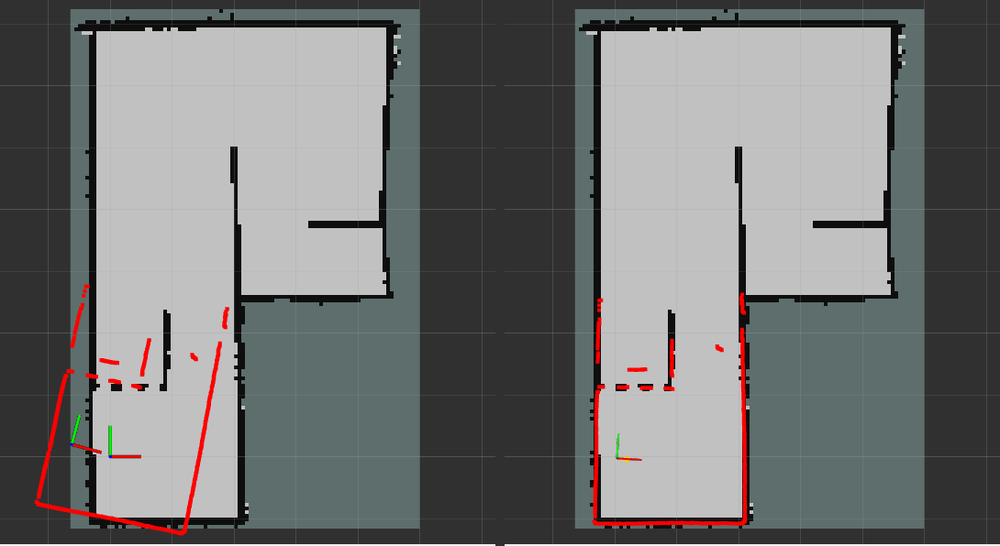

Si corrés el paso 5 sin localizar (con `map → odom` fijo), las tres cajas
igual pueden caer adentro de los 25 cm, pero la última queda a unos 24 cm:
a un centímetro de perder la mitad de los puntos. Con tu localizador queda
a unos 3 cm.

### Comprobación

- El lidar calza con el mapa de punta a punta del bag.
- La nube de partículas se mantiene chica, sin partirse en dos grupos.
- Los puntos de `/scan_rojo` caen siempre en los mismos tres lugares, donde
  están las cajas rojas.

Preguntas:

- Mirá el principio del bag, antes de que el robot arranque. ¿Qué pasa con
  las partículas mientras el robot está quieto? ¿El lidar calza exacto con
  el mapa? Corré el bag dos o tres veces: ¿da siempre lo mismo? (Pista: mirá
  cuánto ruido agrega `mover_particulas` cuando el robot no se movió, y qué
  hace `recibir_scan` en cada scan.)
- Buscá en el bag los momentos en que las partículas se abren un poco.
  ¿Qué está haciendo el robot? ¿Qué ve el lidar?
- ¿Qué pasaría si el robot arrancara a 30 cm del origen? ¿Y girado 45°?
  Probalo cambiando `pose_inicial_x` y `pose_inicial_theta`.

### Desafío extra: probar AMCL

En la [semana 09](../semana-09-nav2/) reemplazaste tu filtro por AMCL, el
de Nav2. Probalo contra el bag y comparalo con el tuyo.

AMCL no necesita `map_server`: se suscribe a `/map` y recibe el mismo mapa
que tu localizador. En tu launch, en lugar de `campo_verosimilitud` y
`localizador`, levantá AMCL con la configuración de la semana 09 y un
lifecycle manager que lo active:

```python
Node(package='nav2_amcl', executable='amcl', output='screen',
     parameters=['<ruta a semana-09-nav2/nav2_params.yaml>', {'use_sim_time': True}]),
Node(package='nav2_lifecycle_manager', executable='lifecycle_manager',
     parameters=[{'use_sim_time': True, 'autostart': True, 'node_names': ['amcl']}]),
```

Con el bag en pausa, dale la pose inicial con **2D Pose Estimate** en RViz,
como en la semana 09, y recién después arrancá el bag.

Con esa configuración AMCL no se pierde, pero sigue al robot con bastante
más error que tu filtro: en varios tramos el lidar queda corrido unos
10 cm de las paredes. Mirá en `nav2_params.yaml` estos
parámetros y pensá cuáles tienen sentido en un laberinto de menos de
3 × 4 m:

- `update_min_d` y `update_min_a`: cuánto se tiene que mover el robot para
  que AMCL use un scan nuevo.
- `sigma_hit`, `z_hit` y `z_rand`: cuánto confía en que cada punto del
  lidar pega en una pared del mapa.
- `alpha1` a `alpha5`: el ruido de su modelo de movimiento, como tus `gamma`.

Pregunta para pensar: tu localizador corrige con cada scan que llega. ¿Cada
cuánto corrige AMCL con esta configuración? ¿Qué pasa con la pose entre una
corrección y la siguiente?

---

## Paso 5: Llevar las cajas rojas al mapa y reportarlas

Ya tenés todo lo necesario: el robot localizado (paso 4) y los puntos del
lidar que caen sobre rojo (paso 2). Falta pasar de esos puntos a **una
posición por caja, en su centro**, y publicarla en `/victimas`. Al final
vas a ver cuántos puntos sacás.

### Teoría: de los puntos de una cara al centro de la caja

Tu detector de la [semana 07](../semana-07-obstaculos-no-mapeados/), corriendo
sobre `/scan_rojo`, publica un punto por cada racha roja del lidar: el
promedio de los puntos de una cara de la caja. Tiene dos problemas para
reportar:

- **Son muchos.** Cada scan que ve la caja agrega un punto, así que en todo
  el bag son cientos. Hay que juntarlos en uno por caja.
- **Están en la cara, no en el centro.** El lidar ve la cara que mira al
  robot. El centro está media caja más lejos, en la dirección en que el
  robot ve la caja. Con cajas de ~18 cm, son ~9 cm de diferencia.

Juntar con la **mediana** y no con el promedio hace que unos pocos puntos
malos (por ejemplo, los que se corren en un giro, como viste en el paso 2) no
muevan el resultado.

Hay un tercer problema, que aparece cuando el robot está muy cerca de una
caja. Los rayos del lidar que pasan **justo al costado** de la caja no la
tocan y pegan en lo que haya detrás, a veces más de un metro más lejos.
Pero la cámara y el lidar no miran desde el mismo lugar, y de cerca esa
diferencia pesa: en la imagen, esos rayos caen sobre el borde de la caja
roja. `detector_scan` los marca como rojos, y como son varios seguidos,
tu detector de la semana 07 los toma como una racha. Por eso
`juntar_victimas` descarta las detecciones que están demasiado lejos del
robot.

En esta captura el robot está pegado a la caja de la izquierda. Además de
los puntos verdes sobre la caja, aparecen otros abajo a la izquierda, en la
sala del punto de partida: son los rayos que pasaron al costado de la caja.

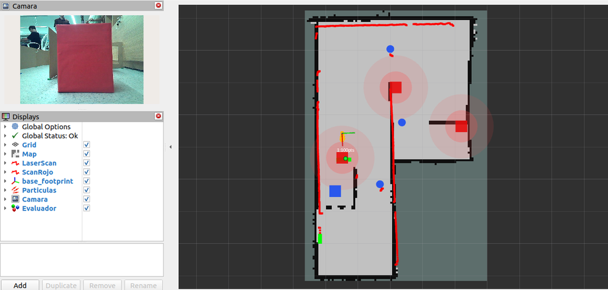

### El evaluador

Para saber si te dio bien, te damos el paquete
[`evaluador_victimas`](evaluador_victimas/). Tiene los centros reales de las
cajas del bag y hace esto:

- Escucha `/victimas` y acepta **solo tres reportes**, porque hay tres cajas
  rojas. Los que lleguen después se ignoran.
- Cada reporte se asigna a la caja roja más cercana. Si está a 0,25 m o
  menos del centro, vale **100 puntos**; hasta 0,5 m, **50**; más lejos, 0.
  Cada caja cuenta una sola vez, con su mejor reporte.
- Un reporte mal formado (`frame_id` distinto de `map`, o una coordenada
  NaN o infinita) gasta un intento y da 0.
- En la terminal escribe cada reporte con su distancia y el puntaje total.
- En RViz (`MarkerArray` en `/evaluador/marcadores`, con `Durability Policy`
  en **Transient Local**) dibuja las cajas reales, las zonas de 0,25 y 0,5 m
  alrededor de cada caja roja, y cada reporte con su número y sus puntos.
  También dibuja la caja azul y los conos azules: un reporte ahí no da
  puntos.

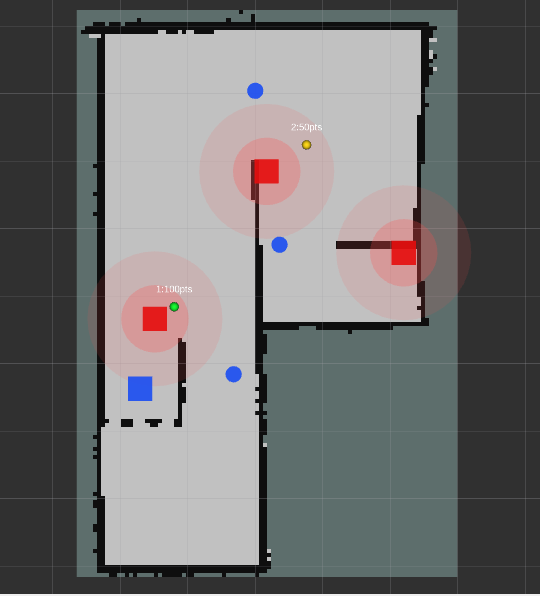

Podés probarlo sin el bag, mandando un reporte a mano:

```bash
source ~/rosmaster_ws/install/setup.bash
ros2 topic pub --once /victimas geometry_msgs/msg/PointStamped "{header: {frame_id: map}, point: {x: 0.3, y: 1.3}}"
```

### Qué hacer

**1. La semana 07 sobre `/scan_rojo`.** Sumá tu `detector_obstaculos` a tu
launch, escuchando `/scan_rojo` en vez de `/scan` y publicando en
`/objetos_rojos` (con `remappings`). Probá primero con los parámetros de
siempre y fijate qué cajas aparecen. Dos de las cajas están contra una
pared, y para el campo de verosimilitud un punto a pocos centímetros de una
pared "ya está en el mapa". Pero acá ese filtro sobra: los puntos de
`/scan_rojo` ya son rojos. Subí `umbral_probabilidad` a 101 para que pasen
todos.

**2. `juntar_victimas.py`.** Te lo damos con TODOs:
[`juntar_victimas.py`](juntar_victimas.py). Copialo a tu paquete, registralo
como ejecutable y completá las tres funciones marcadas:

- `recibir_objetos`: descartar las detecciones lejanas y pasar cada una de
  la cara al centro.
- `agregar`: sumarla al grupo que corresponda, o crear uno nuevo.
- `quizas_publicar`: publicar el grupo en `/victimas` cuando junta
  suficientes detecciones.

Sus parámetros:

| Parámetro | Default | Qué es |
|---|---|---|
| `victimas` | 3 | Cuántos reportes publicar como mucho |
| `detecciones_minimas` | 10 | Cuántas detecciones tiene que juntar un grupo antes de publicarlo |
| `radio_grupo` | 0.30 | Distancia máxima (m) a la mediana de un grupo para sumarse a él |
| `mitad_caja` | 0.09 | Cuánto correr cada detección de la cara al centro (m) |
| `distancia_maxima` | 1.5 | Las detecciones a más de esta distancia del robot (m) se descartan |

Sumalo a tu launch.

**3. El evaluador.** Compilá `evaluador_victimas` y sumá a tu RViz un
`MarkerArray` en `/evaluador/marcadores` (Transient Local). El evaluador va en
su propia terminal, como el mapa: no es parte de tu código.

```bash
source ~/rosmaster_ws/install/setup.bash
cd ~/rosmaster_ws
colcon build --packages-select evaluador_victimas
```

Las terminales ahora son cuatro:

```bash
# Terminal 1: el bag, en pausa
source ~/rosmaster_ws/install/setup.bash
ros2 bag play ~/rosmaster_ws/bags/laberinto_victimas --clock -p
```

```bash
# Terminal 2: el mapa
source ~/rosmaster_ws/install/setup.bash
ros2 launch mapa_laberinto mapa.launch.py
```

```bash
# Terminal 3: el evaluador
source ~/rosmaster_ws/install/setup.bash
ros2 launch evaluador_victimas evaluador.launch.py
```

```bash
# Terminal 4: tu launch
source ~/rosmaster_ws/install/setup.bash
ros2 launch <tu_paquete> <tu_launch>.launch.py
```

> [!NOTE]
> **Si el puntaje te da peor de una corrida a otra, mirá la carga de tu
> computadora.** El localizador está en Python: si la computadora está muy
> cargada (por ejemplo, grabando la pantalla, o con el bag a velocidad ×2),
> se atrasa en los giros y las posiciones salen corridas. Corré el bag a
> velocidad normal.

> [!NOTE]
> **El evaluador no se reinicia solo.** Cuando usa sus tres reportes, ignora
> todo lo que llegue después, aunque vuelvas a correr el bag desde el
> principio. Antes de cada corrida, cerrá la Terminal 3 y volvé a abrirla.

### Qué vas a ver

La primera caja se reporta a los ~35 s del bag, después de que el robot la
ve a través de las ventanas; las otras dos, entre los 85 y los 100 s, cuando
el robot pasa por la sala de la derecha. Cada reporte aparece en RViz con sus
puntos (bag a velocidad ×4):

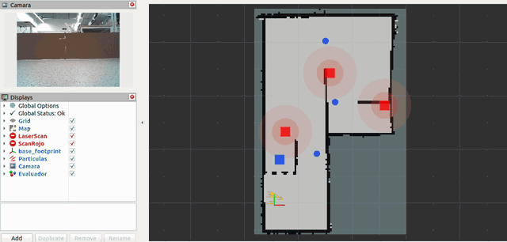

Al final del bag:

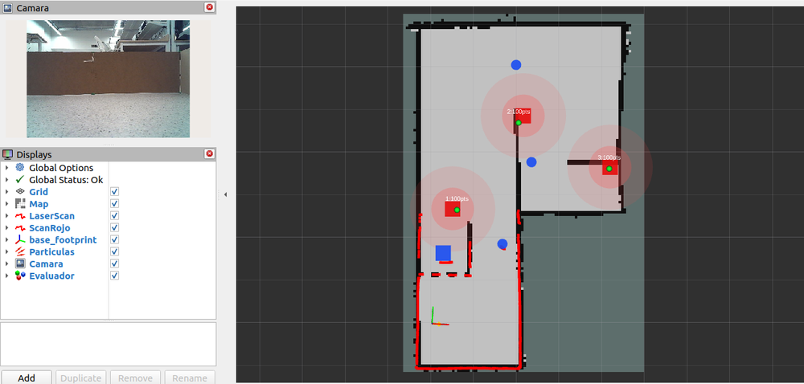

En la terminal del evaluador vas a ver algo así:

```text
Reporte 1/3 en (...): a 0.019 m de la caja roja 1.
Puntaje: 100 de 300 (1/3 reportes usados)
Reporte 2/3 en (...): a 0.088 m de la caja roja 2.
Puntaje: 200 de 300 (2/3 reportes usados)
Reporte 3/3 en (...): a 0.032 m de la caja roja 3.
Puntaje: 300 de 300 (3/3 reportes usados)
```

### Comprobación

- Los tres reportes caen dentro de la zona de 0,25 m de su caja: 300 de 300.
- Ningún reporte cae sobre la caja azul ni sobre los conos.
- Tu nodo publica exactamente tres veces: no hay "Reporte ignorado" en el
  evaluador.

Preguntas:

- Corré con `mitad_caja` en 0. ¿A qué distancia del centro quedan los
  reportes? ¿Para qué lado se corren y por qué?
- Corré con `distancia_maxima` en 10 (sin filtro). ¿Qué reporta? Mirá en
  RViz los puntos de `/scan_rojo` cuando el robot está pegado a la caja de
  la izquierda: ¿dónde caen?
- ¿Qué pasa con `detecciones_minimas` en 30? Una de las cajas no llega
  nunca: ¿cuál, y por qué el lidar la ve tan poco?
- Una de las cajas está apoyada torcida contra la pared. ¿Cómo la ve el
  lidar? ¿Qué parte de la caja termina reportando tu nodo?
- Cambiá la mediana por el promedio en `agregar` y `quizas_publicar`.
  ¿Cambia el resultado? ¿En qué caso cambiaría mucho?
- Si tu detector de rojo confundiera la caja azul o un cono con algo rojo,
  ¿qué reportaría `juntar_victimas`? ¿Cuántos puntos perderías?
